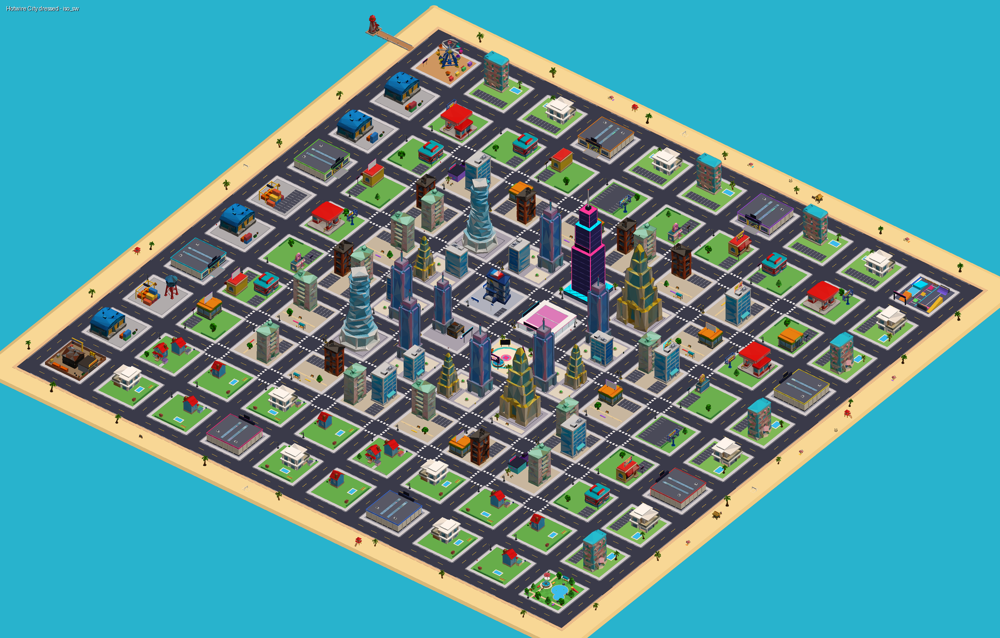

# 🚗💨 Hotwire City

**Steal cars. Outrun the cops. Stack cash.**

Hotwire City is a cartoon open-world car-heist game for Roblox. Every car you steal has to be **driven home** through a chase. Cars parked in your garage print money every second. Rare cars, mutations, server-wide **Hot Drops**, and other players' garages full of loot keep the loop going.



## What's in the game

- **Core loop**
  1. Hotwire a parked car, carjack traffic, or pull a dealership heist.
  2. Escape a wanted level of 1–5★ (police AI ram you, box you in and bring a chopper).
  3. Drive the car into your garage's DROP-OFF, where it earns $/s.
  4. Collect, upgrade, then go after rarer cars.
- **Stealing from other players**
  - You can steal from other players' garages, then you have to drive the car home.
  - Owners fight back with a Bonk Bat, a Zapper and Spike Strips, and they get revenge and recovery bonuses.
  - Fair-play rules:
    - a laser lock on every garage;
    - newbie protection;
    - a cooldown on each victim;
    - offline garages can't be robbed;
    - a dropped car is never deleted.
- **Cars**
  - 32 cars across 8 rarities. The meme cars include the Rubber Ducky, Hotdog Wagon, Couch Cruiser and Toilet Turbo.
  - 5 mutations: Gold, Diamond, Rainbow and Galaxy, plus a Car Index with completion bonuses.
  - Every car has a custom textured 3D mesh, which we made and uploaded ourselves.
- **Driving**
  - Arcade raycast physics, with drifting, nitro and auto-flip.
  - On mobile, touch controls and auto-accelerate.
  - A car radio with 5 stations (licensed APM music).
  - Other players see your nitro flames and hear your horn.
- **World**
  - An island city with districts: neon Downtown, Midtown, Suburbs, Beachfront, Docks, the Park, a Pier with a ferris wheel, and a Stunt Park.
  - 106 kit buildings and 317 props, plus parody billboards.
  - Pedestrians, NPC drivers, cops and shopkeepers in catalog outfits.
  - A day/night cycle that ends in a neon night.
- **Retention**
  - offline earnings
  - a 7-day streak and daily contracts with a free reroll
  - playtime gifts (per day)
  - rebirths
  - codes
  - friend, group and referral bonuses
  - leaderboards
- **Events:** Hot Drop (a mythic car spawns and the whole server races for it), Cash Rain, Rush Hour, 2× Cash and Server Luck.
- **Rating:** built for **Mild**. There is no blood, no death, and no realistic weapons. Getting caught means **BUSTED → impound**.

Docs:
- [`docs/SPEC.md`](docs/SPEC.md): design and engineering contract.
- [`docs/RESEARCH.md`](docs/RESEARCH.md): market and engine research.
- [`docs/ART_PASS.md`](docs/ART_PASS.md): the art pipeline.
- [`docs/integration/`](docs/integration): audit findings, decisions and fix reports.
- [`docs/previews/`](docs/previews): renders of the cars, garages, city and HUD.

---

## Quick start: play it in Studio

You need [Rojo](https://rojo.space) 7.6+.

```bash
rojo build -o HotwireCity.rbxlx     # or use the prebuilt build/HotwireCity.rbxlx
```

Open `HotwireCity.rbxlx` in Roblox Studio and press **Play**, or use **Test → Start Server + 2 Players**. The city and garages are generated, then dressed with the 3D asset kit once it loads.

> **The 3D art loads only in a place owned by the same account that owns the assets (`illintent1`).** It is loaded at runtime with `InsertService:LoadAsset`. In any other place, or when offline, the game falls back to its built-in procedural art automatically, and everything still works.

In Studio, every player is an admin. Use the chat:

- `/hc cash 1000000`
- `/hc car hover_car Rainbow`
- `/hc wanted 5`
- `/hc hotdrop`
- `/hc event doublecash`
- `/hc help`

For live sync while you edit: run `rojo serve` and connect from the Rojo Studio plugin.

## Publishing checklist

1. **File → Publish to Roblox** as a new experience, on the **same account that owns the uploaded assets**.
2. **Game Settings → Security:**
   - turn on **Enable Studio Access to API Services**, which DataStores need;
   - turn on **Allow Loading Third Party Assets**, which only the 12 optional Creator Store fills need. Everything else is owned.
3. **Game Settings → Places → Max Players: 8.** There is one garage per player.
4. **Monetization:**
   - Create the passes and products listed in `src/shared/Config/Monetization.luau`.
   - Paste their ids into that file and rebuild.
   - Anything with id `0` stays hidden. Diamond Dragster is a one-time purchase.
5. **Group bonus (optional):** set `Economy.GROUP_ID` in `src/shared/Config/Economy.luau`.
6. **Maturity questionnaire:** answer for **Mild**: cartoon, non-lethal, no blood or gore, no gambling, no realistic weapons.
7. **Icon and thumbnails:** use `marketing/roblox_ready/`. Before launch, swap at least one thumbnail for a real in-game capture. For social teaser clips, see `marketing/teasers/`; read its README for which clips are safe to post.
8. **Launch timing:** GTA VI is expected on **Nov 19, 2026**, and search interest in "open-world car heist" peaks around then.

## Project layout

```
src/shared   -> ReplicatedStorage.Shared       Config/*, Util/*, Vehicle/* (CarBuilder, VehicleController), Net, Remotes, Types
src/server   -> ServerScriptService.Server      init.server.luau + Systems/* (one module per system) + Config/* (server-only)
src/client   -> StarterPlayerScripts.Client     init.client.luau + Controllers/* + UI/* (Kit, Theme)
src/first    -> ReplicatedFirst.Loading         LoadingScreen.client.luau
tests/       -> Lune unit tests + harness (runs the real modules headlessly)
tools/       -> geometry/GLB renderers, Open Cloud upload + smoke-test tools, decimation, asset-config generator
assets/      -> source GLBs (hero + kit), upload manifests, Creator Store curation
docs/        -> SPEC, RESEARCH, ART_PASS, integration reports, previews
marketing/   -> icons, thumbnails, billboard art, concept art, teaser clips
```

Balancing lives in `src/shared/Config/*.luau`. It covers cars, rarity and witness odds, the economy, police, events, vehicle physics, sounds and assets.

## Tooling

| Command | What it does |
|---|---|
| `rojo build -o HotwireCity.rbxlx` | Builds the place |
| `selene src` / `stylua src` | Lint (full Roblox API std) and format (Luau) |
| `lune run tests/run.luau` | Runs 500+ unit tests against the real source in a Roblox-like harness |
| `lune run tools/dump.luau car all out.json && python3 tools/render.py out.json cars.png` | Renders the procedural cars |
| `python3 tools/preview_dressed.py` | Renders the dressed city using the real GLB meshes (slow: about 13 min) |
| `python3 tools/glb_preview.py in.glb out.png` | Inspects and renders any GLB |
| `python3 tools/decimate_glb.py in.glb out.glb 9000` | Reduces triangles while keeping the texture (Roblox limit is 20k per mesh) |
| `python3 tools/upload_hero.py <key> <glb> "<name>" <yaw> <size> --manifest … --fit …` | Uploads a mesh to Roblox through Open Cloud and records it |
| `python3 tools/gen_assets_config.py` | Regenerates `Config/Assets.luau` from the manifests |
| `python3 tools/cloud_smoke.py <universeId> <placeId> HotwireCity.rbxl` | Uploads a Saved version and runs a headless real-engine boot check (Luau Execution) |

Open Cloud tools read the API key from `ROBLOX_API_KEY` or `~/.config/hotwire/roblox_api_key`, never from the repo. Toolchain versions are pinned in `rokit.toml`.

## Asset pipeline

How the custom 3D art was made:

1. Higgsfield `gpt_image_2_5` concept render.
2. `image_to_3d` (Meshy) or `sam_3_3d` → textured GLB.
3. `glb_preview.py` checks orientation; `decimate_glb.py` brings it to ≤ 20k triangles (cars to about 9k).
4. Open Cloud upload as a Roblox Model asset.
5. `gen_assets_config.py`, then `AssetLibrary` loads, normalizes and dresses the world at runtime.

Totals: 33 vehicles, 22 buildings and 41 props, all moderation-approved. Twelve 2D images (billboards, logo, loading art) were uploaded as Image assets.
