# GTA-grade asset sourcing for v2

Date: 2026-10-27. Binding context: `docs/v2/research/00_LEAD_DIRECTION.md` (grounded GTA V realism, guns with no gore, Moderate 13+). This note lists assets that can replace the v1 cartoon set. Every table row was checked by eye against its thumbnail. Only items rated **4 or 5** for realism are in the tables; notable 3s are listed under each table.

## How to read this

- **R** is a 1–5 realism verdict against GTA V. 5 means "would not look out of place in GTA V/IV at Roblox scale". 4 means "realistic, small compromises". 3 means "acceptable filler or semi-stylized".
- **Thumb** paths are relative to this file. Contact sheets with every candidate (kept and rejected) are in `img_gta/assets_*.jpg`.
- **ID links**:
  - Creator Store models and audio: `https://create.roblox.com/store/asset/<id>`
  - Avatar catalog items: `https://www.roblox.com/catalog/<id>`
  - Catalog bundles: `https://www.roblox.com/bundles/<id>`
  - Sketchfab: `https://sketchfab.com/3d-models/<uid>`
  - Poly Haven: `https://polyhaven.com/a/<id>`
- **Data sources** (all queried 2026-10-27):
  - Creator Store search: `apis.roblox.com/toolbox-service/v2/assets:search`
  - Catalog search: `catalog.roblox.com/v1/search/items/details`
  - Bundle contents: `catalog.roblox.com/v1/bundles/<id>/details`
  - Thumbnails: `thumbnails.roblox.com/v1/assets` and `/v1/bundles/thumbnails`
  - Verified badges: `users.roblox.com/v1/users`
  - Sketchfab: `api.sketchfab.com/v3/search` and `/v3/models?user=` (GLB downloads use the token in `~/.config/hotwire`, never printed)
  - Poly Haven: `api.polyhaven.com`
- **"Verified"**: the Creator Store v2 search marks almost every publisher `verified:true`, which means ID-verified. That is not the blue badge. Real blue badges are marked **(badge)** below. Of the creators checked, only Andru7rs, Natalie_Clabo, Stickmasterluke and CRRAANNNEEEEEEE have one.
- **Repeats**: nothing below repeats an ID from `assets/curation/*.json` or from `src/shared/Config/Sounds.luau`, unless it is marked *(already in repo)*. The gun models, gun SFX and placeholder gun animations chosen in `gta_combat.md` §11 are not repeated here (see §2).

## Decision summary

1. **Cars: build the v2 fleet from Daniel Zhabotinsky's Sketchfab library.**
   - It has 100+ downloadable models under CC BY 4.0, and the author's description adds "I unconditionally give you permission to use this model … or implement it into a digital product".
   - Every car is a **fictional brand** ("Fairheaven", "Negotiator", "Phoenix 455", "Kiri"), so GTA-style parody brands come built in. The models literally look like GTA SA/IV traffic.
   - Two GLBs were opened (Fairheaven LT '80 Cop Cruiser and Kiri '10). Both have **separate `WheelStamp_FL/FR/RL/RR` wheel meshes**, separate hood, trunk, glass, headlight, brakelight and reverse-light meshes, and a body-paint material. They are 13–26k tris, and the textures are a shared "UCB" atlas reused across cars.
   - The fleet covers sedans, coupes, muscle, sports, supercars, SUVs, pickups, vans, box and tow trucks, police (7 cruisers and 5 interceptors), taxis, an ambulance, a fire-chief wagon and an **armored truck**.
   - Gaps are a city bus, a fire engine, a SWAT van, modern super/hyper cars and motorcycles. They are filled below from other CC-BY Sketchfab models and Creator Store IDs.
   - Cost: one Blender import, rename, upload pass (task #8), then attribution in `assets/ATTRIBUTION.md`.
2. **Creator Store cars are second best.** The realistic free ones are mostly real-brand replicas (Ford, Honda, Toyota), which brings trade-dress risk and logos to strip. Use them only for a few service vehicles that can be loaded by ID today, such as the CodeAta fire truck and the ryteclipse taxi.
3. **NPCs: Roblox's free "Base Body" bundles (979–995) plus Roblox-made layered clothing (free) are the cleanest realistic pedestrian kit.**
   - Uniforms come from roleplay uniform makers: Pripp and Emergency Response Customs for classic shirts and pants, and verified layered-clothing (LC) tactical kits for SWAT.
   - NPC locomotion: put the **adidas Community / adidas Sports** animation pack IDs into HumanoidDescription. These are catalog avatar animations, so the experience does not need to own them.
4. **Audio: Pro Sound Effects (PSE, Roblox-licensed) covers sirens, horns, skids, crashes, city and freeway ambience, police radio and helicopters.**
   - No licensed per-class engine **RPM loop sets** exist on the Store. The many `LS3_engine_Accel_4201` / `gt3_eng_acl` style uploads are rips from racing games and are rejected.
   - Instead, build loops from long PSE car recordings using `Sound.LoopRegion` (§5.1).
5. **Sky: make our own skyboxes from Poly Haven CC0 "pure sky" HDRIs** (§6.2). Until then, `5186800496` "Sunset SkyBox with sun" is the best Creator Store stand-in.
6. **City: Sketchfab CC-BY packs and Poly Haven CC0 props are far more realistic than the Creator Store.**
   - Sources: TampaJoey, Daniel Zhabotinsky, 99.Miles, aitortilla01, FrodoUndead, spookyghostboo.
   - The current `city.json` curation (Synty, "Cartoon House", "Low Poly …") hits the kill list and should be retired.
   - Creator Store quick wins that load by ID are in §4.3.

---

## 1. Vehicles

### 1.1 Daniel Zhabotinsky fleet (Sketchfab, CC BY 4.0, fictional brands)

Credit line: "Model by Daniel Zhabotinsky (sketchfab.com/DanielZhabotinsky), CC BY 4.0".

All are downloadable GLB files with separate wheels, verified on 2 models (see the decision summary). A third model, Shvan '92 Ambulance, has two wheels both named `WheelStock_RL`, so the importer should assign wheels by position, not by name.

Contact sheets: `img_gta/assets_cars_sketchfab_daniel_1.jpg` and `_2.jpg`.

| Use | Sketchfab uid | Name | Tris | Thumb | R |
|---|---|---|---|---|---|
| **Police cruiser (hero)** | 61766c1e6e1e4b2b803c174f33433a74 | Fairheaven LT '80 Cop Cruiser | 19.5k | 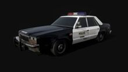 | 5 |
| Police cruiser | 945fd09f513f4d1ab19b6388a7ea7323 | Negotiator '80 Cop Cruiser | 21.0k | 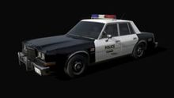 | 4 |
| Police cruiser | dc81625478a744649b210c7f248b0b6a | Illinois '90 Police cruiser | 19.7k | 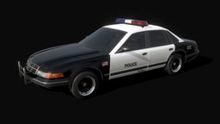 | 4 |
| Police cruiser (90s) | 31f0ac0f03ad42e3bbf236b3ecb2049e | Murphy '97 Cruiser | 17.4k | 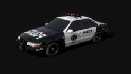 | 4 |
| Police cruiser | 13de926717214b8a94eaf90b0f0067d6 | Murphy '92 Cop Cruiser | 16.7k | 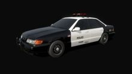 | 4 |
| Police interceptor (4★) | 63aa215521334cef9c4d8c4c391252ad | Saba V12 '95 Interceptor | 25.4k | 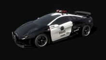 | 4 |
| Police interceptor | cd19005ea4c5415d834adebdd6c9bb56 | Gallo '99 Interceptor | 24.5k | 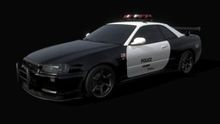 | 4 |
| Police interceptor | fbd5b96599944932a71fc8c81291253c | Phoenix 455 '71 Interceptor | 26.5k | 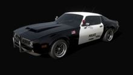 | 4 |
| **Armored truck event** | 26e809cce40e4359a3199649f12ef295 | MD '84 Armored | 20.4k | 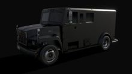 | 5 |
| **Taxi** | 9e8f92a215784f3d8aaaaeab1bef54c4 | Canyon '75 Taxi | 20.0k | 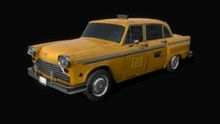 | 5 |
| Taxi | 72d91f4bce814818b3cd1f2de60f8ef2 | Illinois '90 Taxi #1 | 19.9k | 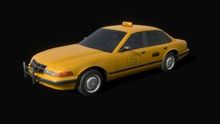 | 4 |
| **Ambulance** | 2856dd3c61f940909dced9a5c0379484 | Shvan '92 Ambulance | 25.9k | 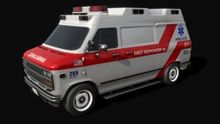 | 5 |
| Fire chief car | 0cd661aaab6949ba9d77dbb13ab146c5 | Fairheaven SW '80 Fire Dept. | 21.3k | 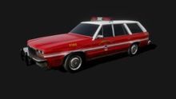 | 4 |
| Sedan | e2678da920cc4be68dbc193727919ffb | Fairheaven LT '80 | 19.7k | 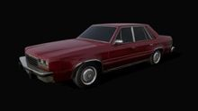 | 4 |
| Sedan | 892b2684fb37442299bfad9222cf331c | Negotiator '80 | 19.7k | 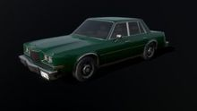 | 4 |
| Sedan (90s) | d604871eee5b4181bb298163b0b675b7 | Illinois '90 | 19.4k | 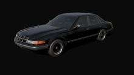 | 4 |
| Sedan (luxury) | 3af773617c7f481da2ba5d307412ce35 | Carter '98 | 19.9k | 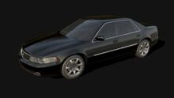 | 4 |
| Sedan (modern) | 32ac065960334899afc8ff6fbb2d79ee | Trinity '03 | 19.6k | 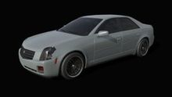 | 4 |
| Sedan (import) | d43bb748da364af2b3f0a9348365f0fb | Tozzo '98 | 17.9k | 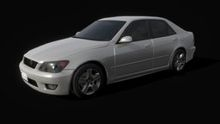 | 4 |
| Compact (modern) | 7fd6e15785fa4aa9bfd6e31eb7c97ba6 | Kiri '10 | 13.0k | 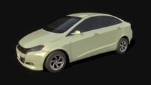 | 4 |
| Compact (modern) | 055ff8a21b8d4d279debca089e2fafcd | Ace '11 | 18.4k | 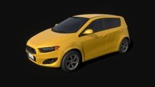 | 4 |
| Compact (modern) | 25c6874d173a4f6ca63e150bbd505686 | Compact '07 | 15.1k | 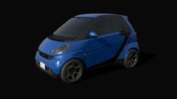 | 4 |
| Hatch (modern) | 22abe5284d4c4b55920b8462eb24a8c1 | Sigil '07 | 17.0k | 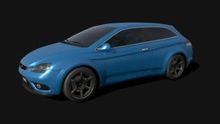 | 4 |
| Crossover / SUV | 2866efdfa943484391ef8313768e074d | Urban '10 | 16.6k | 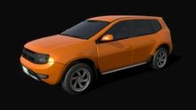 | 4 |
| **Muscle** | 955edc733c6d44fabc0ad7c246a15896 | Phoenix 455 '71 | 25.9k | 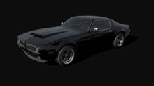 | 5 |
| Muscle | 46fed79f600c4fc69e060991f9e3e4f9 | Duke '69 | 18.6k | 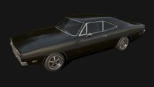 | 4 |
| Muscle (modern) | 857f048c4bbb40b4be4fb0b765a52116 | Exterminator '00 | 14.8k | 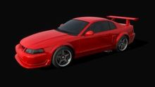 | 4 |
| Muscle | 8419d645064e4b1699d970375e1c3cc7 | Palomino Special '67 | 16.4k | 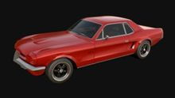 | 4 |
| Muscle (lowrider base) | 41b3a5c0bc534817b3311c3736c403e6 | El Alamo '78 | 16.2k | 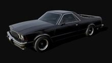 | 4 |
| Sports | 6dd4ae19c454414d9eed2bc524515d78 | JDM Sport '99 | 23.2k | 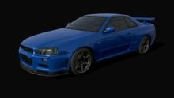 | 4 |
| Sports | 25a4ff2002834ec1b4441c57ecd7ca9f | Thunderbolt '96 | 18.8k | 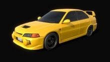 | 4 |
| Sports | 776078e51fbe4ec9addbe45ba13e1aad | NFR '90 | 16.9k | 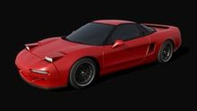 | 4 |
| Sports roadster | 82fd2008ce304df688ec4dfcd42d41ce | Roadster '00 | 15.9k | 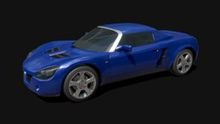 | 4 |
| Coupe | 8918b07a427443cd8d1b334d9ad213a5 | Tiara GT '83 | 18.8k | 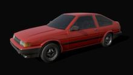 | 4 |
| Coupe | ef6411864cd24046aad6ae75dbdb7ea7 | Hazer Turbo '81 | 25.8k | 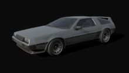 | 4 |
| Super | 3ab977050c334c13b6abb5de078b4957 | Saba V12 '95 | 24.6k | 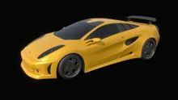 | 4 |
| Super (80s) | c967ab4abbc54ae4b7933fd81a86c99c | Cheetah '84 | 23.3k | 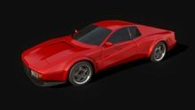 | 4 |
| SUV (classic) | 22015d1863d6455aa31cfd738b972c50 | Bokaroo '67 | 28.3k | 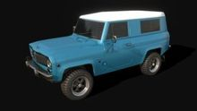 | 4 |
| SUV (off-road) | 22732575b0644cc9b65cf21857288189 | Eugene MK6 '65 | 26.2k | 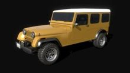 | 4 |
| Lifted SUV | 67beae18c3d24be68f9c8f0ec382d8e3 | Lightbody Lifted '85 | 37.4k | 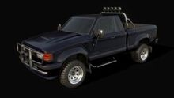 | 4 |
| Pickup | 6c48c94be8974dc7a5932f697c0ba68f | Conquer '89 Pickup | 21.1k | 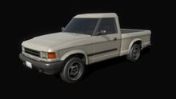 | 4 |
| Pickup (HD) | 3b3ac59245c44872b06ad85673be9643 | Lightbody '90 MD Pickup | 27.1k | 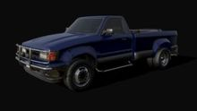 | 4 |
| Utility truck | d3aca50a8f2b4917bb9f4ce2bf1ccfe5 | Lightbody '90 MD Utility | 26.6k | 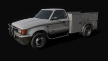 | 4 |
| Tow truck | 5cba208001c64e8ea164f89e4dde91e7 | Lightbody '90 MD Tow Truck | 26.2k | 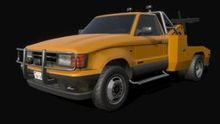 | 4 |
| Flatbed | 39195e554c7a41a2884186c10d5079c0 | Lightbody '90 MD Flatbed | 24.1k | 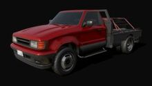 | 4 |
| Box truck | 663a0953c038434a918cb85725c88ffa | LCT 3000 '95 | 18.9k | 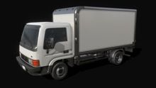 | 4 |
| Box truck (modern) | 3be03b6a43aa41898c9ca806b8787052 | LCT 3000 '07 | 15.8k | 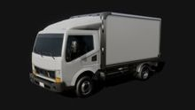 | 4 |
| Van | 09d718c9cf72401b8534d265a06a803f | Shvan '92 | 23.0k | 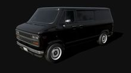 | 4 |

Notable 3s:
- Hot rods (Coupe '33 #1–#3).
- Club '90 golf cart.
- Colby '80 microcar.
- RC Shvan.
- The "Retro Styled" sub-2k models: too low-detail next to the rest.

Caveat: the fleet skews 1965–2011, so it reads GTA SA/IV more than GTA V. Pair it with the modern models in §1.2, and with the Roblox Endorsed Sedan, SUV, Sports Car and Supercar that are already curated.

### 1.2 Other Sketchfab vehicles (CC BY 4.0)

Contact sheet: `img_gta/assets_cars_sketchfab_misc.jpg`.

| Use | uid | Name — author | Tris | Thumb | R |
|---|---|---|---|---|---|
| **City bus** | 14fe03d792914d51b6c6250b393c44fd | Generic Town Bus — own.guest (1,085 likes) | 55.5k | 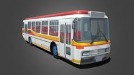 | 4 |
| **SWAT van (5★)** | 5b9076973cda47e98609640d745bb8ce | SWAT Police Van — Zack_Hawley | 23.5k |  | 5 |
| Fire engine | 27a6b95f768d415282e2f5de48ba6d99 | Firetruck — OzerGokmen | 26.5k | 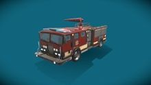 | 4 |
| Garbage truck | 21d0c35687894e3aa2ee2814da21fcf2 | Autocar McNeilus Refuse Truck — Trashbulldogproductions (debadge) | 47.8k |  | 4 |
| Modern SUV | edc994ad28ed438cb365c0e0389ac177 | Lowpoly Generic SUV — mk2design | 8.0k |  | 4 |
| Police SUV | 259fc16c23d548ba8d5802c563d8ebdc | Lowpoly Generic SUV Police — mk2design | 9.0k |  | 4 |
| Sports sedan | a161542c38ac44fca3b1c283f6d986bb | Generic Toyama XR Sedan — mk2design | 24.9k |  | 4 |
| Sports coupe | 2e1a3699de7e4f688d328dc005ef1aac | Generic Coupe "Azura" — mk2design | 36.2k |  | 4 |
| Supercar | f5420af7b30c4e8c874be33cc58724f2 | Generic Supercar "Cheetah" — mk2design (+ "Cheetah Polizia" e78ae8f923bd4dafb805849c88358bda) | 29.2k |  | 4 |
| Ambulance (light) | b78313c16c9d46a7a67643245cf278d2 | Ambulance — mk2design | 4.1k |  | 4 |
| Highway patrol | 3d85e608d2c847c58577074faa134cbc | Highway Patrol Cruiser — jeandiz | 12.2k |  | 4 |
| Motorcycle (naked) | 9e79295e99654e2a9fa930b5139a7d84 | Low-Poly Motorcycle #2 — Sidramax | 46.0k |  | 4 |
| Motorcycle (custom) | 13771fe558604aedae09b5157029e790 | Custom Bike "JAWA" (low-poly) — kreems | 42.6k |  | 4 |
| Motorcycle (classic) | f121301624174b179ca4d50158797b03 | Honda CB 750 F — Alex.Ka. (real brand, debadge) | 37.0k |  | 4 |
| Chopper | 7d446ec9135c4e35892714d117b37268 | Harley Davidson Breakout — FWSean (real brand, debadge) | 41.3k |  | 4 |
| Wreck props | ad16f7085cb047b494997cf9efed5059 | Free Burned Police Cars — kryik1023 (1,406 likes) | 21.6k |  | 4 |

Notable 3s:
- Coach bus (own.guest).
- "Maintenance vehicles" (ondrasaur).
- LowPoly Fire Truck (jg-3d, EU-style).
- "Burned-out Cars" (kryik1023, too low-poly).

There are no CC0 cars of note: the Sketchfab `license=cc0` search returns museum scans, and Poly Haven only has `covered_car`.

### 1.3 Creator Store vehicles (load by ID, no upload)

Contact sheets: `img_gta/assets_cars_creatorstore_1.jpg`, `_2.jpg` and `assets_cars_zoom.jpg`.

Rules for all of them:
- Strip every script.
- Keep the `Body` shell only.
- Recolor paint parts.
- Real brands must be debadged.

| Use | ID | Name — creator | Tris / MeshParts / scripts | Price | Thumb | R |
|---|---|---|---|---|---|---|
| **Fire truck (brush)** | 8062915410 | [FREE]Fire Truck — CodeAta (60 votes, 83%) | 61.3k / 18 / 0 | free |  | 5 |
| **Taxi** | 11721302627 | Generic Taxi — ryteclipse | 26.9k / 14 / 33 | free |  | 4 |
| Taxi (classic) | 97528551904169 | Taxi Checker Marathon — Andru7rs **(badge)** | 71.5k / 86 / 0 | $14.99 |  | 4 |
| Ambulance | 77108240540599 | International Ambulance — LB_xXTY | 50.3k / 60 / 16 | free |  | 4 |
| Garbage truck | 1961916823 | Garbage Truck — JuriaanT | 18.0k / 21 / 0 | free |  | 4 |
| Van ("Burrito") | 6048783847 | Chevrolet Van — edgarevaristo (30 votes, 88%; debadge) | 43.6k / 51 / 8 | free |  | 4 |
| Box truck | 9471929131 | box truck — bilalels1234 (20 votes, 82%) | 36.0k / 81 / 9 | free |  | 4 |
| Muscle | 11657272318 | Muscle car (Prop) — epik_altt | 25.7k / 38 / 0 | free |  | 4 |
| Police sedan | 3505841542 | Crown Victoria Police Car — Ravenhasabird57 (debadge) | 43.2k / 116 / 83 | free |  | 4 |
| Police SUV | 119704692640803 | Ford Police Interceptor (Unscripted) — yudhistiar85 (debadge) | 40.9k / 27 / 0 | free |  | 4 |
| Unmarked SUV | 7221082792 | Undercover Chicago Police Car — OutrageGamerOfficial (100 votes, 88%) | 77.1k / 89 / 30 | free |  | 4 |
| Coupe (fictional brand) | 8796987666 | 1988 Avanta Zeta Avard Coupe — Avanta Car Company (group) | 71.3k / 111 / 26 | free |  | 4 |
| Wagon (fictional brand) | 7577642257 | 1988 Avanta Zeta "Spacewagon" — Avanta Car Company (40 votes, 98%) | 46.7k / 112 / 29 | free |  | 4 |
| Tuned coupe (fictional brand) | 8773525646 | SVE V6 Avanta Zeta Coupe — Savanacko | 52.5k / 117 / 19 | free |  | 4 |
| Semi + trailer | 18295767892 | peterbilt semi-truck pulling trailer — legocityman18 (debadge) | 11.8k / 25 / 0 | free |  | 4 |
| Hypercar | 6810376207 | 2019 Sports Car // Rosh — BadboyWestern (20k votes, 89%; Koenigsegg Jesko replica) | 97.2k / 77 / 14 | free |  | 4 |

Notable 3s:
- HNTR_ros "Sedan" 82206215080551 and "Modern Box Van" 95730896644903 ($2.99, untextured, GTA-shaped).
- Hyper_verse "Large Car Prop Pack" 89304119350162 ($5.99, white paintable shells).
- NYC School Bus 602448527.
- "(Working Trailers) Semi Truck Project" 4154648933.
- JP_TOCro Marked Police Car 87180228800630 ($3.99, Japanese).
- yiypoo1024's scriptless real-car replicas, for example 2005 Ford Focus 128684873795168 (10k tris) and 2012 Ford Escape Taxi 126316512320938. They are realistic but real brands.

*Already in repo*: SWAT Truck 1961653516 and the Roblox Endorsed set (6418230807, 6418239833, 6418234850, 6433323089, 6433330180).

---

## 2. Guns, gun animations, gun SFX

`gta_combat.md` §11 already holds the chosen set. Nothing there is repeated:
- the Regole_CKC realistic gun models;
- melee and armor;
- PSE and Audioscape gun SFX;
- the placeholder Blaster and Weapons Kit animations.

New findings:

- **Animation ownership rule (blocking).** A plain `Animation` asset only plays in an experience owned by the same user or group, or when Roblox owns it.
  - Every community gun animation pack must therefore be re-published under the Hotwire owner from its KeyframeSequences. Examples: "R15 Gun Animations" 3631707712 by yellowinventor (100 votes, 95%) and "r15 gun animations [ORIGINAL]" 13408250226 by ItsThatSided (29 anims). Both contact-sheet thumbnails show only a rig, so neither is rated. Preview them in Studio first.
  - Plan v2 aim, fire and reload anims as our own uploads, made in-house or retargeted from these. Do not plan them as load-by-ID.
- **NPC reactions that work without ownership.** Roblox-owned emotes, applied through `HumanoidDescription:SetEmotes` and played with `Humanoid:PlayEmote` (verify on NPCs in Studio):
  - **Cower** 4940597758 (flee and cower)
  - **Point2** 3576823880
  - **Salute** 3360689775 (cops)
  - **Shrug** 3576968026
- **Extra gun SFX** not in the combat note. These are licensed uploads, but the ratings come from metadata only; the clips were not listened to.

| Use | ID | Name — uploader | Dur | R |
|---|---|---|---|---|
| Rifle shot round-robin | 132664682779274, 131680727683073, 137933239773333 | AK_SHOT-05 / -07 / -08 — Audioscape | 2–4 s | 4 |
| Suppressed pistol | 138728682241099, 78217892181882 | AS_silenced_pistol_shot-01 / -04 — Audioscape | <1 s | 4 |
| Reverberant gunshot (alley) | 9114725473 | Gun Retort 3 (SFX) — PSE | 4 s | 4 |
| Distant firefight bed (heist) | 9116353775 | Machine Gun Battle 5 (SFX) — PSE | 37 s | 4 |
| Rifle bolt / charge | 9116357355, 9116357621 | Machine Gun Bolt 2 / 4 (SFX) — PSE | 1 s | 4 |

---

## 3. NPC avatars (HumanoidDescription)

How to use these:
- Apply them through `Players:CreateHumanoidModelFromDescription` or `Humanoid:ApplyDescription`. Public catalog items do **not** need to be owned for NPCs.
- Items can still be taken offsale or deleted, so keep a fallback per slot. Roblox-made items are the safest.
- Classic `Shirt`/`Pants` (2D) are the cheapest choice for crowds. Layered clothing (LC) looks much better but costs more to load, so use it on hero NPCs (cops, SWAT, gang leaders) and close peds.

Contact sheets: `img_gta/assets_npc_bodies.jpg`, `assets_npc_civ.jpg`, `assets_npc_police.jpg`, `assets_npc_police_acc.jpg`, `assets_npc_hats.jpg`, `assets_npc_street.jpg`.

### 3.1 Bodies and heads (Roblox-made, free)

**Base Body bundles**: realistic proportions, dynamic heads, varied skin tones, and the 2023 Roblox idle and walk set. Part asset IDs come from `catalog.roblox.com/v1/bundles/<id>/details`.

| Bundle | Name | Torso / Head / LArm / RArm / LLeg / RLeg | Thumb | R |
|---|---|---|---|---|
| 983 | Base Body – Charlie | 11572083496 / 11572085825 / 11572074613 / 11572079320 / 11572076845 / 11572081357 |  | 4 |
| 985 | Base Body – Parker | 11584241181 / 11584333045 / 11584231502 / 11584238141 / 11584235843 / 11584239464 |  | 4 |
| 988 | Base Body – Addison | 11702287641 / 11702291006 / 11702279057 / 11702284438 / 11702282072 / 11702286099 |  | 4 |
| 984 | Base Body – Glenn | shares Charlie parts |  | 4 |
| 991 | Base Body – Dawson | 11709869073 / 11709871094 / 11709862883 / 11709865568 / 11709864101 / 11709867346 |  | 4 |
| 573 | Oliver (dynamic head, Rthro anims) | 3963871432 / 12778883791 / 3963861732 / 3963867514 / 3963864909 / 3963869770 |  | 4 |
| 572 | Summer | 3963485362 / 12853000475 / 3963476651 / 3963481369 / 3963479563 / 3963483107 |  | 4 |
| 722 | Denny | 6445268819 / 128985581083096 / 6445260402 / 6445263379 / 6445262286 / 6445265102 |  | 4 |
| 337 | City Life Woman (Rthro) | 2492674027 / 15093243863 / 2492667589 / 2492669375 / 2492671662 / 2492670347 |  | 4 |

The other Base Body variants are 979 Riley, 980 Cameron, 982 Peyton, 986 Devin, 987 Kayden, 989 Harper, 990 Robin, 992 Rene, 993 Andi, 994 Jordan and 995 Billie. They all rate 4; vary them with `HeadColor`/`BodyColors` and hair.

Notable 3s:
- "Realistic Male Body" 52179038679057 (Ryzie).
- "boy face Latino head" 142347556296633 (VVinner Beauty, badge; beauty-filtered).

Rejected:
- "Man" 238 and "Woman" 239: blocky, on the kill list.
- The "Realistic … Face" heads: meme faces.

### 3.2 NPC locomotion and idle animations (catalog animation packs)

Put these in `HumanoidDescription.IdleAnimation`, `WalkAnimation`, `RunAnimation` and so on. They are avatar items, so the experience does not need to own them. Verify on NPCs in Studio.

| Pack (bundle) | Idle / Walk / Run / Jump / Fall | Use | R |
|---|---|---|---|
| adidas Community (2623795) — adidas, badge | 126354114956642 / 106810508343012 / 124765145869332 / 115715495289805 / 93993406355955 | default pedestrians (mocap, natural) | 5 |
| adidas Sports (427999) | 18538150608 / 18538146480 / 18538133604 / 18538153691 / 18538164337 | joggers, gang members, cops on foot | 5 |
| Rthro (356) — Roblox, free | 2510235063 / 2510242378 / 2510238627 / 2510236649 / 2510233257 | fallback | 4 |
| Bold by e.l.f. (331856) | 16744209868 / 16744219182 / 16744214662 / 16744212581 / 16744207822 | confident walkers (business district) | 4 |

The Run ID for adidas Community was inferred from bundle order: the other six item types were confirmed, the economy API rate-limited the seventh.

Notable 3: Catwalk Glam (1601900), too stylized for crowds.

### 3.3 Civilian clothing

Rows marked **Roblox** are Roblox-made and free.

| Role | ID | Name — creator | Type | Thumb | R |
|---|---|---|---|---|---|
| Suit jacket | 12300764586 | Black Business Tuxedo Blazer — Eternos Digital (V) | LC Jacket |  | 5 |
| Suit pants | 12331823194 | Black Business Tuxedo Pants — Eternos Digital | LC Pants |  | 5 |
| Suit + tie (one piece) | 121486536255417 | Black Blazer w/ Shirt & Tie — ANGVLI | LC Shirt |  | 5 |
| Business coat | 8516638468 | Business Coat – Gray — **Roblox** (also Striped 8516648620, Salmon 8516655378) | LC Jacket |  | 4 |
| Chinos | 14178531985 | Beige Chinos — Eternos (also Black 13958227340, Navy 13958229751, Grey 13958225096) | LC Pants |  | 5 |
| Chinos (black) | 13958227340 | Black Chinos — Eternos | LC Pants |  | 5 |
| Hoodie | 7192553841 | Zip Hoodie – Black — **Roblox** (also Teal 8648389231, Orange 6984765766) | LC Jacket |  | 5 |
| Hoodie (pullover) | 16290250962 | Black Hoodie w/ Rolled Up Sleeves — Eternos | LC Shirt |  | 5 |
| Jacket | 8516620262 | Hooded Jacket – Gray — **Roblox** | LC Jacket |  | 5 |
| Leather jacket | 7192549218 | Leather Jacket – Black — **Roblox** (also Brown 6984767443) | LC Jacket |  | 5 |
| Denim jacket | 8516609675 | Denim Jacket – Light Wash — **Roblox** | LC Jacket |  | 5 |
| Tee | 9112474888 | Basic T-Shirt – Gray — **Roblox** (also Striped White 9112483644, Black 9119670803) | LC T-Shirt |  | 5 |
| Sweater | 9240757332 | Knit Sweater – Black — **Roblox** (also Beige 6984769289, Gray 9240758221) | LC Sweater |  | 4 |
| Overcoat | 8648380153 | Trench Coat – White — **Roblox** | LC Jacket |  | 4 |
| Work pants | 6984740059 | Cargo Pants – Brown — **Roblox** | LC Pants |  | 4 |
| Casual pants | 8721985925 | Motorcycle Pants – Brown — **Roblox** | LC Pants |  | 4 |
| Shorts | 9174391966 | Bermuda Shorts – Black — **Roblox** (also Jean Shorts 7192687500) | LC Shorts |  | 4 |
| Puffer | 9245463297 | Dark Puffer Jacket — FrancklinDay | LC Jacket |  | 4 |
| **Beach shirt** | 9728267998 | Floral Button Down – Forest — **Roblox** (R$105) | LC Shirt |  | 5 |
| Beach shirt | 9342978533 | Red Hawaiian Open Shirt — KelvinBlues1 (V) (also Orange 9342968136, Turquoise 9342985332) | LC Shirt |  | 5 |
| Construction vest | 18863624639 | Neon Green Construction Vest — Builder_Boy UGC Fashion House (also Orange 18863614932) | LC Jacket |  | 5 |
| Hard hat | 16713265880 | hard hat — On Clearance (yellow) | Hat |  | 4 |
| Hard hat (white) | 4036753255 | Hard Hat — WhoToTrus | Hat |  | 4 |

**Shoes** are Roblox bundles: use the Left/Right asset IDs in `LeftShoeAccessory`/`RightShoeAccessory`.

| Bundle | Shoes | Left / Right |
|---|---|---|
| 896 | Sneakers – White | 9482987287 / 9482991343 |
| 894 | Canvas Shoes – White | 9481782649 / 9481786623 |
| 907 | Dress Shoes – Black | 8044843668 / 8044852814 |
| 925 | Dress Shoes – Brown | 8044823721 / 8044826993 |
| 916 | Work Boots – Black | 9542395442 / 9542450828 |
| 882 | Work Boots – Tan | 7193170137 / 7193171232 |
| 930 | Military Boots – Black (cops, SWAT) | 9614836327 / 9614841343 |

All are rated 4.

Notable 3s (classic 2D and cheap, for far-LOD crowds):
- **Roblox** classic jeans: Dark Green Jeans 144076760 and Black Jeans 382537569.
- TIX Clothing+ "Grey Suit w/ Black Vest" 6554200369 / 6555797786.
- Stylish Aviators 376526673 (**Roblox**, free, purple lens).
- Snapback Corduroy Cap 7217158397.

### 3.4 Police, SWAT and EMS uniforms

| Role | ID | Name — creator | Type | Thumb | R |
|---|---|---|---|---|---|
| **Patrol shirt** | 6151216949 | [+] Generic Police Uniform Shortsleeve — Pripp | Shirt |  | 4 |
| Patrol pants | 6151217466 | [-] Generic Police Uniform Bottoms — Pripp | Pants |  | 4 |
| Patrol shirt ("POLICE") | 3246054392 | Generic Police Uniform (Right Handed Loadout) — Emergency Response Customs | Shirt |  | 4 |
| Highway patrol shirt | 5950422289 | [+] Generic State Police – Longsleeve — Pripp (pants 5950422936) | Shirt |  | 4 |
| Sheriff shirt | 6088031234 | [+] Generic Vintage Sheriffs Office Shortsleeve — Pripp | Shirt |  | 4 |
| Sheriff pants | 6766572187 | [-] Generic Sheriff's Office Uniform Variation 3 — Pripp | Pants |  | 4 |
| Patrol vest | 9039294821 | Police Vest Jacket — Reverse_Polarity (V) | LC Jacket |  | 4 |
| Vest (accessory, cheap) | 7213677261 | Police Vest — GuestCapone (V) | Front acc. |  | 5 |
| Duty belt | 70387923298300 | Police Duty Belt w/o Radio — FouledAnchors (V) | Waist acc. |  | 5 |
| Duty belt (alt) | 4376960922 | Police Utility Belt — Reverse_Polarity (V), 57k favorites | Waist acc. |  | 4 |
| Cap (dress) | 6377328912 | Vintage Police Cap — GuestCapone (V) | Hat |  | 4 |
| Cap (ball) | 85862929843857 | Tactical Cap Police (Black) — GRUNT GEAR | Hat |  | 4 |
| Shoulder mic | 9666706628 | Over-Shoulder Radio Mic — JohnDrinkin (V) | Front acc. |  | 4 |
| Radio | 4378176948 | Tactical Shoulder Radio — WhoToTrus (V) | Back acc. |  | 4 |
| Detective / agent earpiece | 4684658997 | Secret Service Earpiece — Reverse_Polarity (V) | Hat |  | 4 |
| **SWAT kit** | 11309698643 | Tactical Operator Kit — Foxtrot Arms (V), 53k favorites | LC Sweater |  | 5 |
| SWAT uniform | 135946439510000 | SWAT Combat Uniform — Foxtrot Arms (V) | LC (bodysuit) |  | 5 |
| SWAT vest | 104624037110020 | Standard Tactical SWAT Vest Kit 1.0 — Optic Enhancements (V) | LC T-Shirt |  | 5 |
| Plate carrier | 9210309228 | Black Modular Plate Carrier — cyutsee (V) | LC Jacket |  | 5 |
| Plate carrier (alt) | 9121409344 | Black Plate Carrier — FouledAnchors (V) | LC Jacket |  | 4 |
| Tactical vest | 9039305349 | Black Tactical Vest — Yourius (V) | LC Jacket |  | 4 |
| SWAT pants | 9352541131 | {BLACK CAMO} SWAT POLICE PANTS — Heptagram Studios | Pants |  | 4 |
| SWAT helmet | 71132585321731 | "SWAT" Navy Tactical FAST Operator Helmet — Forged Tactical | Hat |  | 4 |
| SWAT helmet (plain) | 12715896786 | Black SWAT Helmet — Dualpoint Interactive (V) | Hat |  | 4 |
| Helmet (PASGT) | 85549992031892 | SWAT PASGT Helmet V2 — Hephaestus Manufacturing | Hat |  | 4 |
| Headset | 6602071898 | Tactical Helmet Headset — JohnDrinkin (V) (also Black Tactical Headset 4036737464) | Hat |  | 4 |
| Balaclava (SWAT, robbers) | 6238724671 | Tactical Stealth Balaclava — JohnDrinkin (V) | Hat |  | 4 |
| **Paramedic** | 3338324180 | [EMS] Paramedic Uniform — Emergency Response Customs (pants 3338328569) | Shirt |  | 4 |
| Paramedic jacket | 6276230473 | Generic EMS Paramedic Jacket with gloves — Code 8 | Shirt |  | 4 |

Notes:
- Avoid real-agency patches (LAPD 7524162448, "FBI SWAT" 4691855775) and use the generic sets. GTA parodies them (LSPD, FIB).

Notable 3s:
- Police Sergeants Cap 1081392 (Roblox, cartoon).
- Police Riot Helmet 16469532 (Roblox, dated).
- Tactical Balaclava 4753644287.
- SWAT Chest Armor 9732082221 (sci-fi look).
- Stethoscope 30844997 (Roblox).
- Security High-Vis Vest 13117389872.

### 3.5 Street and gang styles

| Role | ID | Name — creator | Type | Thumb | R |
|---|---|---|---|---|---|
| Robber / street | 92736940480604 | Black Puffer Jacket w/ Cross Balaclava — SVDDENLY | LC Jacket |  | 4 |
| Tracksuit top | 119214918476081 | Tracksuit Trouble Black — #TROUBLE (V) | LC Jacket |  | 4 |
| Tracksuit top (3-stripe) | 136557402387947 | adidas High Contrast Toon Tracksuit Top — adidas (V) | LC Jacket |  | 4 |
| Baggy jeans + boots | 86187501834798 | M11! – Baggy Jeans w/ Timbs boots — M11! (V) | LC Pants |  | 4 |
| Cargo shorts + sneakers | 18548981681 | Black Urban Summer Cargo Shorts — BLUEBERRY (V) | LC Shorts |  | 4 |
| Durag | 12805077075 | Silky Smooth Black Durag — Valkenheim UGC (V) (also Black Side Tied Durag 7028762683) | Hat |  | 4 |
| Chain | 4709123997 | Wallet Chain (1.0) — Builder_Boy (V) | Waist acc. |  | 4 |

Notable 3s:
- "Tilted Cap w Durag" 106773169906463 (shows a fashion-brand logo).
- High Waisted Baggy Denim Jeans 9178819226 (women's street).

---

## 4. City dressing

### 4.1 Buildings (Sketchfab, CC BY 4.0)

Contact sheet: `img_gta/assets_city_sketchfab_buildings.jpg`. These are realistic low-poly buildings with textures, which suits Roblox streaming budgets.

| Use | uid | Name — author | Tris | Thumb | R |
|---|---|---|---|---|---|
| Downtown blocks | 7378e7fb9c914c39880d9913a6f4e1d6 | Downtown Buildings Set — DanielZhabotinsky | 45.6k |  | 5 |
| **Port / industrial (with gantry crane)** | e0b0d0342be24e6c923319991a2a4d3d | Industrial Buildings Set — DanielZhabotinsky | 30.6k |  | 5 |
| Old town walk-ups | b15e6344acd844eabc823e1cc8332574 | Brownstone Building Set — DanielZhabotinsky | 68.4k |  | 4 |
| Strip-mall shops | d5cbc471d20c4c9da31c3df656648916 | Midcity Buildings Set — DanielZhabotinsky | 4.9k |  | 4 |
| Glass office tower | d96380fb001345cca9a9be121f3e43d5 | Atlanta Corporate Office Building — 99.Miles (3,430 likes) | 37.3k |  | 5 |
| Downtown tower | 2305f0fe03ba44229a1f768dcb48bd8f | Singapore Office Skyscraper — 99.Miles | 26.4k |  | 4 |
| Street-front blocks | c4a3993ef1e84e6d9d5a15c78da88aae | Realistic chicago buildings — 99.Miles | 11.6k |  | 5 |
| Warehouses | e6e105d35b3f486292c42ffa52f363c0 | Warehouses — 99.Miles | 1.9k |  | 4 |
| Construction site | 5c134526af464b5389f6c8a29fddeaff | Low Poly Construction Assets — 99.Miles | 4.8k |  | 4 |
| **Miami-style condo (beach)** | b3e16399830045a7b67ec8e02447fd27 | Miami style condominium — aitortilla01 | 7.7k |  | 5 |
| Residential tower | f8c0a550cd1e441f85b46caeba6632f3 | Hi rise apartment building — aitortilla01 | 3.7k |  | 4 |
| Office filler | 4d2c3f3450ef4e849056b88b49873ce2 | Mid rise wall to wall office building — aitortilla01 | 1.9k |  | 4 |
| Office filler | 1f341f8261af4fb6a0dc910c2aae37a6 | Low rise wall to wall office building — aitortilla01 | 1.4k |  | 4 |
| Condo filler | 9e891744efb04f359c88aaed25c0b53f | Low Rise Modern Condo 3 — aitortilla01 (also Condo 2 2aaa4c5fb7c24e829973ea4576db41ba) | 4.3k |  | 4 |
| **Hills mansions** | a26bde27281641eba1b889e927d138e5 | Mansion 5 — aitortilla01 (also Mansion 1 c68044a625e9429f9ca6c11fc1756037, Mansion 2 30b40452eb384e59953ef9e772caa18f) | 5.3k |  | 4 |

Notes:
- "The Vizcayne, Miami" (2f326604f2c34a09b3dcf3d6f8e3fd4b) is a real landmark. It is realistic, but use it only as a modelling reference.
- Poly Haven's CC0 `modular_urban_apartments_facade` (118k) and `modular_factory_facade` (175k) are photoreal but must be decimated heavily. Their thumbnails are in `assets_props_polyhaven.jpg`.

### 4.2 Street furniture and props (Sketchfab CC BY 4.0 / Poly Haven CC0)

Contact sheets: `img_gta/assets_city_sketchfab_props.jpg` and `assets_props_polyhaven.jpg`.

| Use | Source id | Name — author | Tris | Thumb | R |
|---|---|---|---|---|---|
| **US street kit** (traffic mast-arm, stop sign, hydrant, dumpster, poles) | sf 27a6775c51e44bfda8e1ac8725eb3e9e | Street and City Props Dumpster Traffic Light — spookyghostboo | 16.2k |  | 5 |
| **US road signs (MUTCD)** | sf c39bf97110494b5db3de84165211f592 | Road Signs — FrodoUndead (1,394 likes) | 14.3k |  | 5 |
| **City props** (bus shelter, benches, bins, planters, meters) | sf 2f52ea53c58e455f9b69d11f58763c96 | City Props Collection (volume 2) — TampaJoey | 52.2k |  | 5 |
| City props vol. 1 | sf 32b8b82bb1e9489c993799c91967a916 | City Props Collection volume 1 — TampaJoey (**Sketchfab Free Standard licence**, not CC: commercial use OK, no redistribution of the source) | 70.8k |  | 5 |
| Chain-link fences | sf 777e50cd6e5d4db99d70bf7b20370f7a | Chain link fence pack — TampaJoey | 17.6k |  | 5 |
| Roadwork barriers | sf 209e7dc032de483cae12eb5c3e7f1bcf | Barricade Set — TampaJoey | 8.2k |  | 5 |
| Billboard frame | sf 20d1a51fbfa94373900e29de74a0f9ee | Billboard (.psd layered) — TampaJoey | 11.3k |  | 5 |
| Freeway sign gantry | sf 6534d76c592d4a0da374d3861e2d506a | Metal road billboard single sided — Frice | 0.9k |  | 5 |
| Street kit (signs, fences) | sf f3eb47d02e2e4ab290e66752fa354b48 | Street Asset Pack — vmatthew (1,557 likes) | 37.8k |  | 4 |
| Freeway pieces | sf 6776eeb54b7c45bfa51dd0fa7edc2830 | Highway (Modular) [Street Assets Vol. 04] — whisper.alt | 12.2k |  | 4 |
| Gas station | sf 8fcd52f1b12e4b4296589b4c6328b777 | Gas station Props — Elbolilloduro | 12.7k |  | 4 |
| **Palm** | sf 26e787f2ff2e4c0fb004c3b0210805a3 | Coconut Palm — evolveduk | 7.4k |  | 5 |
| Palms (set) | sf 55690379305145488e20afb05fc687e6 | Palm Trees — yadrogames | 2.9k |  | 4 |
| Port containers | sf cc3f7136710f4905905eae1d10ac50b7 | Shipping containers — jeandiz (48 tris) | 0.05k |  | 4 |
| Container (hero) | sf 772f4be391a245f699c54e6cf157c58d | Classic Shipping Container — Sebastian.Hamish.Webster | 17.1k |  | 4 |
| Container (rusted) | sf 2b787d1a02174d0bbca9eac34eb3a486 | Freight shipping container – Rusted — sousinho | 11.1k |  | 4 |
| **Yacht** | sf 0dd451f295d049cea20c17d3ffa87ee3 | Yacht — sergeif | 8.5k |  | 5 |
| Jersey barrier | ph concrete_road_barrier | Concrete Road Barrier — Poly Haven, CC0 (decimate) | 80.8k |  | 5 |
| Hydrant | ph fire_hydrant | Fire Hydrant — Poly Haven, CC0 (decimate) | 86.3k |  | 5 |
| Utility boxes | ph utility_box_01 / utility_box_02 | Utility Box 01 / 02 — Poly Haven, CC0 | 4.4k / 6.3k |  | 5 |
| Trash can | ph metal_trash_can | Metal Trash Can — Poly Haven, CC0 | 14.0k |  | 5 |
| Manhole | ph water_manhole_cover | Water Manhole Cover — Poly Haven, CC0 | 6.3k |  | 5 |
| Fire escapes | ph modular_fire_escape | Modular Fire Escape — Poly Haven, CC0 | 11.3k |  | 5 |
| Shop shutters | ph rollershutter_door | Rollershutter Door — Poly Haven, CC0 | 1.1k |  | 5 |
| Power poles | ph modular_electricity_poles | Modular Electricity Poles — Poly Haven, CC0 (decimate) | 200k |  | 4 |
| Chain-link (photoreal) | ph modular_chainlink_fence | Modular Chainlink Fence — Poly Haven, CC0 | 89.2k |  | 4 |

Notable 3s:
- Poly Haven `street_lamp_01` / `_02` are European lantern style.
- whisper.alt "Traffic Lights [Vol. 02]" (ab3efdd259a54d4aba5f878eacbe3f20) is EU-style.
- ahmagh2e "Street light" (77b0a1e448f14b47b9dc62881a241850): wooden-pole countryside light.
- Elbolilloduro "Bus stop" (619d27fc93f24be1a7d6994906ca4620): a scene, not a prop.

### 4.3 Creator Store props (load by ID)

Contact sheet: `img_gta/assets_props_creatorstore.jpg`.

| Use | ID | Name — creator | Tris / scripts | Thumb | R |
|---|---|---|---|---|---|
| Jersey barriers | 79210720504422 | Jersey Barrier Pack — Regole_CKC (the same creator as the recommended guns) | 9.8k / 0 |  | 5 |
| US traffic light (mast arm) | 4477106901 | (WORKING) Realistic Traffic Light — baxzzi (200 votes, 95%) | 9.7k / 3 |  | 4 |
| Traffic light + street light | 13752790025 | Realistic Traffic Light — skelewizz | 2.9k / 5 |  | 4 |
| Signal heads | 1014237387 | STES Advanced Traffic Signals — Hydrolock (30 votes, 88%) | 37.1k / 0 |  | 4 |
| Street light (US) | 4049929892 | Realistic Street Light — Infinite_Tungsten (also Double 4049898662) | 2.1k / 2 |  | 4 |
| Palm (cheap) | 10562894034 | Palm Tree (Realistic) — Natalie_Clabo **(badge)** (300 votes, 93%) | 0.3k / 0 |  | 4 |
| Palm | 471214939 | Realistic Palm Tree — Narrakin (200 votes, 93%) | 1.0k / 0 |  | 4 |
| Container | 77003885266485 | Shipping Container — B_CaIhoun | 5.6k / 0 |  | 4 |
| Sail yacht (marina) | 1023383822 | Sail yacht — SheamusOCallaghan | 17.5k / 0 |  | 4 |
| Speedboat (classic) | 15676599201 | Riva Aquarama Classic Yacht — Saykous (real brand, debadge) | 4.0k / 0 |  | 4 |
| Tower crane | 569765324 | (FREE!) Liebherr EC-B Flat-top Tower Crane — CRRAANNNEEEEEEE **(badge)** (debadge) | 28.4k / 0 |  | 4 |
| Tower crane + shell | 11935041829 | tower crane and unfinished apartment — SolarisTrollino (20 votes, 100%) | 21.5k / 0 |  | 4 |
| Bench | 74128359748221 | Realistic Park Bench [PBR] — Revbuilds | 3.7k / 0, $2.99 |  | 4 |
| Dumpster | 118336156580063 | Industrial Trash Dumpster PBR — proloxSimba | 18.9k / 0, $2.99 |  | 4 |

Notable 3s:
- Gantry Crane 3416199767.
- Hydrant 13452054366.
- Advanced Chain Link Fence Set 1847259857.
- WovenZane street light 12117717385 (realistic but 50k tris).
- frchrono "PBR Low Poly City Prop Pack" 81016908843472 ($3.99).

Rejected: "GTA V Traffic Signal" 5207702908, a likely rip.

---

## 5. Audio (Roblox-licensed uploads)

Ratings for audio are made from the publisher's metadata and descriptions only: there was no audio playback in the container. Listen in Studio before locking anything.

PSE means "Pro Sound Effects" (user 7462895450), whose uploads are licensed for Roblox use. *Already in repo* means `Config/Sounds.luau` already uses it: Wail 1 and 2 (9119165131 / 9119165140), the skid 9119186024, the peel-out 9113661285, Crash 9118708982, Metal Crash 4 9116546593, Glass 9114590297, Horns 9114402205 / 9114402206, CityAmbience 9112758500, Traffic 9112891352 and the engine loop 80317022777602.

### 5.1 Engines: per-class loops built with `Sound.LoopRegion` from long PSE takes

| Class | ID | Name | Dur | Loop from | R |
|---|---|---|---|---|---|
| Sedan / wagon | 9112969603 | 1978 Chevy Impala Station Wagon 2: start, rev, fast drive, idle | 193 s | idle and cruise segments | 4 |
| **Muscle V8** | 9112735119 | 1969 Chevrolet Chevelle Convertible 2: on-board exterior, start, idle, revs | 65 s | idle and revs | 5 |
| Muscle cruise | 9112734734 | 1969 Chevrolet Chevelle Convertible 1: on-board, idle, slow constant | 56 s | constant | 4 |
| Sports / super | 9125556863 | Ferrari 308: start, idle, hard booming revs | 58 s | idle and rev | 4 |
| Pickup | 9125346606 | 1988 Chevy Pickup: deep humming idle with big revs | 21 s | idle | 4 |
| SUV (interior) | 9113001368 | 1991 Range Rover: interior idle | 23 s | idle | 4 |
| Semi / truck | 9112736299 / 9112736315 | 1995 Peterbilt Semi: driving constant, slow to idle | 46 / 88 s | constant | 4 |
| Truck idle | 9112971190 | 1979 Mack Semi Truck 2: idle | 130 s | idle | 4 |
| Motorcycle (sport) | 9114895897 | Kawasaki Z1000 Z1-R 2: long high-rpm revs | 46 s | revs | 4 |
| Chopper | 9114780946 | Harley Davidson Panhead 2: kick start, idle, revs | 103 s | idle | 4 |
| Hot-rod pass-by | 9114833135 | Hot Rod Fast Maneuvers 3 | 2 s | one-shot | 4 |

Rejected: the "LS3_engine_Accel_4201", "gt3_eng_acl_8458", "S63B44" and "hellcat_exh" RPM sets. They are rips from racing-game sound banks by anonymous uploaders.

### 5.2 Sirens, horns, skids, crashes, car foley

| Use | ID(s) | Name | Dur | R |
|---|---|---|---|---|
| US yelp | 9119165420 | Siren Yelp 1: start, away, back in, stop | 32 s | 5 |
| Distant pursuit (looping bed) | 9112871822, 9112871933 | Siren Composite 1 / 2: group of police cars, distant, wailing, loop | 56 / 61 s | 5 |
| Distant city sirens | 9119162812, 9119163012, 9119163030 | Siren Bys Wailing 1–3: distant, reverberant | 90 / 55 / 57 s | 4 |
| Cop pull-away | 9117810961 | Police Siren Slow Vehicle Away 2: wail and whoop | 11 s | 4 |
| Fire truck | 9119163479 | Siren on Truck 1 | 11 s | 4 |
| Car horn variants | 9114402335, 9114402340, 9114402481, 9114402619 | Ferrari 308 Dual Air Horns 4/5/7/9 | 1–2 s | 4 |
| Truck air horn | 9114075665, 9114075678, 9114075901, 9114075649 | Diesel Truck Air Horn Exterior 1–4 | 3–4 s | 5 |
| Skid | 9120399080, 9120399166, 9120399077, 9120399191 | Vehicle Skids Long Heavy Tire Squeal 1–4 | 6–17 s | 5 |
| Drift / maneuvers | 9126158715, 9126159053 | Vehicle Skidding Maneuvers, many tire squeals | 14 / 11 s | 4 |
| Screech approach | 9125420012 | Cadillac Tire Screech Fast Approach | 13 s | 4 |
| Crash (big) | 9118709021 | Ronking Car Crash 2 | 18 s | 5 |
| Crash (hits) | 9116546326, 9116546358, 9116547037, 9116546968, 9116547012 | Metal Crash 2/3/7/8/9 | 4–5 s | 5 |
| Truck hit | 9120369181 | Vehicle Crash 2: semi truck hit, metal and glass | 2 s | 5 |
| Glass | 9114600644 | Glass Crash 1 | 11 s | 4 |
| Car alarm (theft) | 9113719289, 9113719335 | Car Alarm Exterior Van Yelp Alarm | 12 / 35 s | 5 |
| Alarm chirp (lock) | 9113719080, 9113719083 | Car Alarm Chirp 1 / 2 | 1 s | 5 |
| Doors | 9112956007, 9112956206, 9112981756 | 1965 Jaguar E-Type open/close 1 and 2; 1986 Cadillac de Ville door slam | 1–5 s | 4 |

### 5.3 Ambience, police radio, helicopters

| Use | ID(s) | Name | Dur | R |
|---|---|---|---|---|
| **Freeway (LA)** | 9112784654, 9112784174, 9112784190, 9112784381 | Freeway Traffic 1–4: Southern California, active, loop | 56 s | 5 |
| Downtown day | 9112891382, 9112891671 | Urban Traffic 1 / 3: NYC overhead, siren wailing, horns | 46 / 95 s | 5 |
| Downtown night | 9112819963, 9112819974 | Las Vegas Night Traffic 1 / 2 | 36 / 46 s | 4 |
| Waterfront | 9112867198 | San Francisco 4: piers, traffic, honking, harbor | 46 s | 4 |
| Port | 9112870248, 9112789988 | San Pedro Harbor 1; Harbor Air 3 (night docks) | 36 s | 5 |
| Suburbs night | 9112834179, 9112834403 | Neighborhood Ambience 4 / 5 (Austin, crickets, distant traffic) | 36 s | 4 |
| Distant traffic | 9112771906 | Distant Traffic 1: freeway wash, loop | 27 s | 4 |
| Pass-bys | 9120390581, 9126158111 | Vehicle Pass Bys Multiple Cars; Highway Various Car Pass By | 26 / 7 s | 4 |
| **Police radio** | 9117744553, 9117748943, 9117775821, 9117769457 | Police Radio 7 / 8 / 19 / 1: LAPD scanner, dispatcher, beeps | 3–5 s | 5 |
| Police radio | 9117172133, 9117172130, 9117173156 | Oregon Police 7 / 8 / 15: radio comms | 3–5 s | 4 |
| EMS dispatch | 9114311190 | Emergency Radio 2: ambulance dispatcher, squelch | 4 s | 4 |
| Walkie (SWAT, heist) | 9120457296, 9120457641 | Walkie Talkie 5 / 7: futzed voices | 17 / 37 s | 4 |
| Taxi radio | 9117099496 | New York City Taxi Radio 3 | 5 s | 4 |
| **Police heli hover** | 9113417360 | Bell Huey Helicopter Hover, hovering fly-by | 46 s | 4 |
| Heli pass | 9125390086, 9113416405 | Bell Huey short maneuver overhead; approach, fly-by, away | 29 / 23 s | 4 |

Notes:
- Police Radio 7 "talk of Hollywood" names a real place. It is fine as ambience, but avoid any clip that recites real addresses.
- PSE has no modern turbine police-helicopter loop; Huey blade-chop is the closest.

---

## 6. Skyboxes

### 6.1 Creator Store (Sky objects, load by ID)

Contact sheet: `img_gta/assets_sky_creatorstore.jpg`.

| Use | ID | Name — creator | Thumb | R |
|---|---|---|---|---|
| **Golden hour (stand-in)** | 5186800496 | Sunset SkyBox with sun — DotDDotexe (1,000 votes, 97%) |  | 5 |
| Day, scattered clouds | 8238531417 | Realistic Skybox — everythingbot3 (200 votes, 88%) |  | 4 |
| Day, clean gradient | 11219565245 | Realistic Clear Skies — TrainMaker6 (60 votes, 94%) |  | 4 |
| Day, hazy clouds | 11832261916 | Realistic Clouds skybox — FlipGalaxy (100 votes, 94%) |  | 4 |
| Dusk | 5133032250 | HD Sunset Skybox — PeZsmistic (60 votes, 100%) |  | 4 |
| Overcast / pre-rain | 5215835022 | HD Cloudy Skybox — PeZsmistic |  | 4 |
| Pink dusk over sea | 407719830 | Sunset Skybox — vexiad (200 votes, 98%) |  | 4 |
| Dawn | 325545295 | Sunset Dawn Skybox — dearjournal (200 votes, 93%) |  | 4 |
| **LA smog / desert haze** | 18618104331 | Dusty Sunset Sky — Axelius (group) |  | 4 |
| Rain | 15068946553 | Gray Cloudy SkyBox — albavulpis (100 votes, 98%) |  | 4 |
| Storm | 11646246511 | Cloudy Skybox — nom_boy123 (80 votes, 95%) |  | 4 |
| Overcast, sunless | 131730008 | Cloudy Skybox Sunless — Stickmasterluke **(badge)** |  | 4 |
| Night overcast | 14217651138 | Realistic Deathly Night (Overcast) — skelewizz (50 votes, 95%) |  | 4 |

Notable 3s:
- "Realistic City skybox" 950893243: a real Hong Kong skyline that would fight our own skyline.
- "Clear Blue Sky" 18586545848: flat gradient.
- alexutzu2001's "HD sky N" series (for example 1613964880 golden hour): photographic, but a grass field fills the lower hemisphere, which looks wrong over the ocean horizon.
- "Realistic Sky (Night and Day)" 3037307834 had a black thumbnail and was not judged.

Rejected: dozens of 2026 "… Skybox Realistic Hdri" re-uploads by "Content Deleted" accounts with 2–8 scripts.

### 6.2 Recommended: our own cube maps from Poly Haven CC0 HDRIs

How: convert equirect to 6 faces at 1024² or 2048², upload as our own images, and set them as `Sky.SkyboxBk/Dn/Ft/Lf/Rt/Up`. Use the "pure sky" variants: the lower hemisphere is a clean horizon, with no ground.

Contact sheet: `img_gta/assets_sky_polyhaven.jpg`.

| Time / weather | Poly Haven id | Thumb | R |
|---|---|---|---|
| Midday, partly cloudy (default day) | kloofendal_48d_partly_cloudy_puresky |  | 5 |
| Clear high sun | autumn_field_puresky |  | 5 |
| Golden hour | kloppenheim_06_puresky |  | 5 |
| Sunset | belfast_sunset_puresky |  | 5 |
| Hazy industrial sunset (port) | industrial_sunset_puresky |  | 5 |
| Dusk | evening_road_01_puresky |  | 5 |
| Overcast (rain weather) | overcast_soil_puresky / mud_road_puresky |  | 5 |
| Fair-weather cumulus | sunflowers_puresky |  | 5 |

For night, Poly Haven has no pure-sky option. `moonless_golf` and `satara_night_no_lamps` both have a ground band, so they rate 3. Use Roblox's procedural night sky plus city light pollution in `Atmosphere`, or crop the upper hemisphere of `satara_night_no_lamps`.

---

## 7. Licence and pipeline notes

- **CC BY 4.0 (Sketchfab).**
  - Credit the author with the title and a licence link in `assets/ATTRIBUTION.md` and on the in-game Credits screen (`SOURCES_UNLOCKED.md`).
  - Strip real logos.
  - The 3 GLBs downloaded for inspection (Fairheaven LT '80 Cop Cruiser, Kiri '10, Shvan '92 Ambulance) are in the scratchpad only. Nothing was uploaded.
- **CC0 (Poly Haven).** No attribution is needed, but credit it anyway. Most models are 20–200k polys and need decimating to Roblox budgets (about 1–5k for props).
- **Creator Store.**
  - Load third-party IDs at runtime (`SOURCES_UNLOCKED.md`).
  - Strip scripts on insert.
  - Paid items ($2.99–$14.99) need a purchase by the owning account first.
- **Real brands.** Ford, Chevrolet, Honda, Peterbilt, Liebherr, Riva, Harley and Kawasaki shapes or names appear on several 4-rated items. They are acceptable as visual bases only after debadging and renaming to parody brands. Prefer the fictional-brand Zhabotinsky and Avanta models for anything the player owns or buys.
- **Animations.** Third-party `Animation` IDs will not play in our experience unless they are re-uploaded under its owner. Catalog avatar-animation and emote IDs set through `HumanoidDescription` are the exception (§2, §3.2).

## Contact sheets (all candidates, including rejects)

| File | Contents |
|---|---|
| `img_gta/assets_cars_creatorstore_1.jpg`, `assets_cars_creatorstore_2.jpg`, `assets_cars_zoom.jpg` | Creator Store cars and service vehicles |
| `img_gta/assets_cars_sketchfab_daniel_1.jpg`, `assets_cars_sketchfab_daniel_2.jpg` | 96 DanielZhabotinsky models |
| `img_gta/assets_cars_sketchfab_misc.jpg` | other Sketchfab vehicles |
| `img_gta/assets_npc_bodies.jpg`, `assets_npc_civ.jpg`, `assets_npc_police.jpg`, `assets_npc_police_acc.jpg`, `assets_npc_hats.jpg`, `assets_npc_street.jpg` | avatar items |
| `img_gta/assets_city_sketchfab_buildings.jpg`, `assets_city_sketchfab_props.jpg`, `assets_props_polyhaven.jpg`, `assets_props_creatorstore.jpg` | city |
| `img_gta/assets_sky_creatorstore.jpg`, `assets_sky_polyhaven.jpg` | skies |
