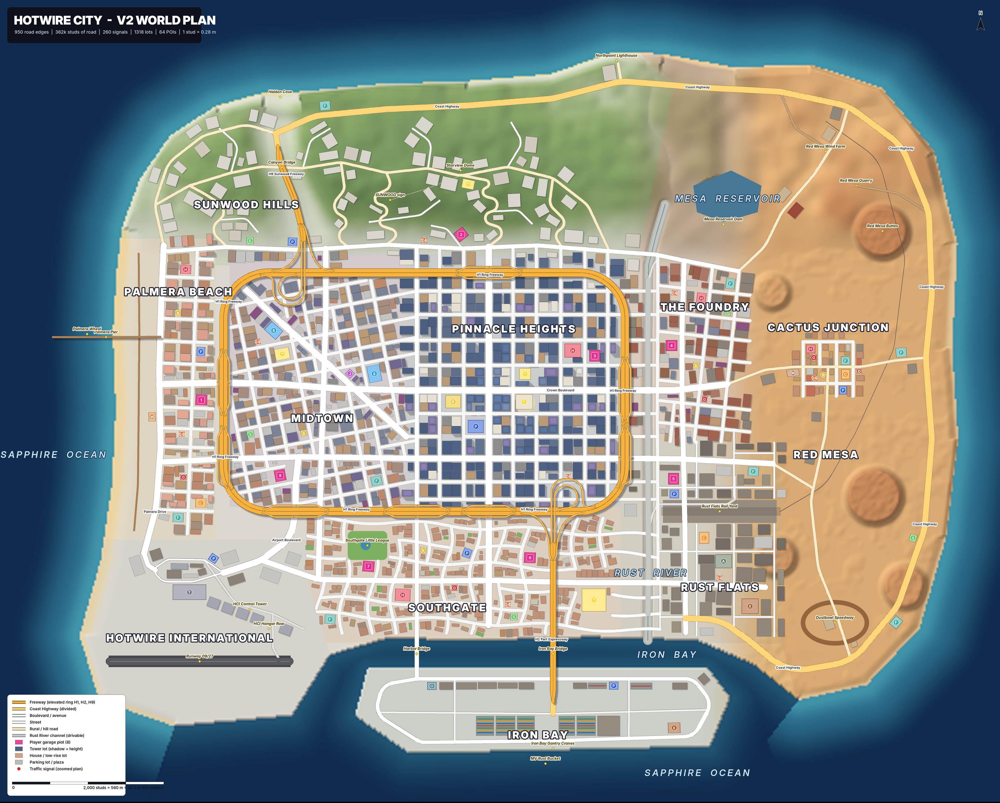
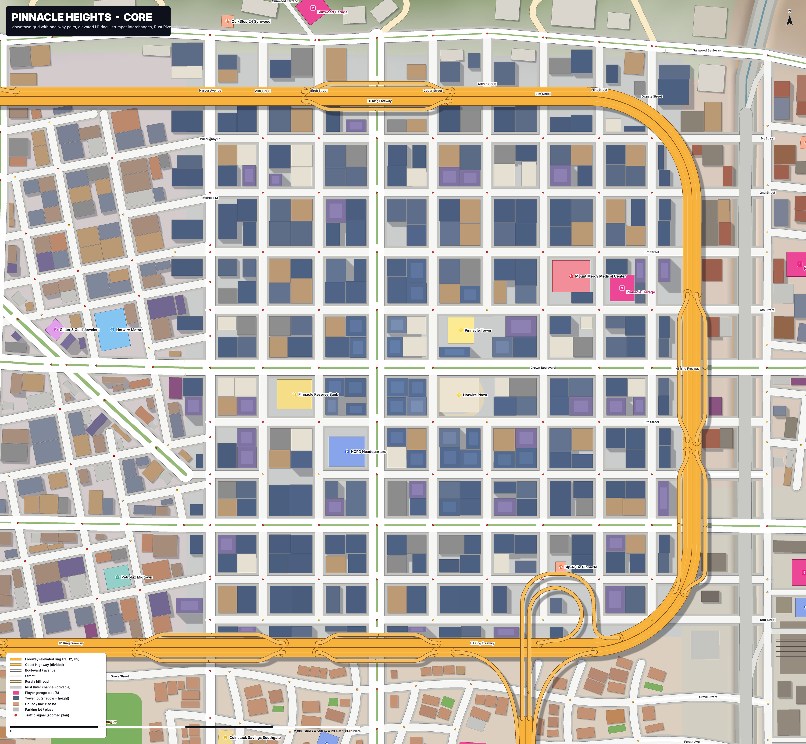
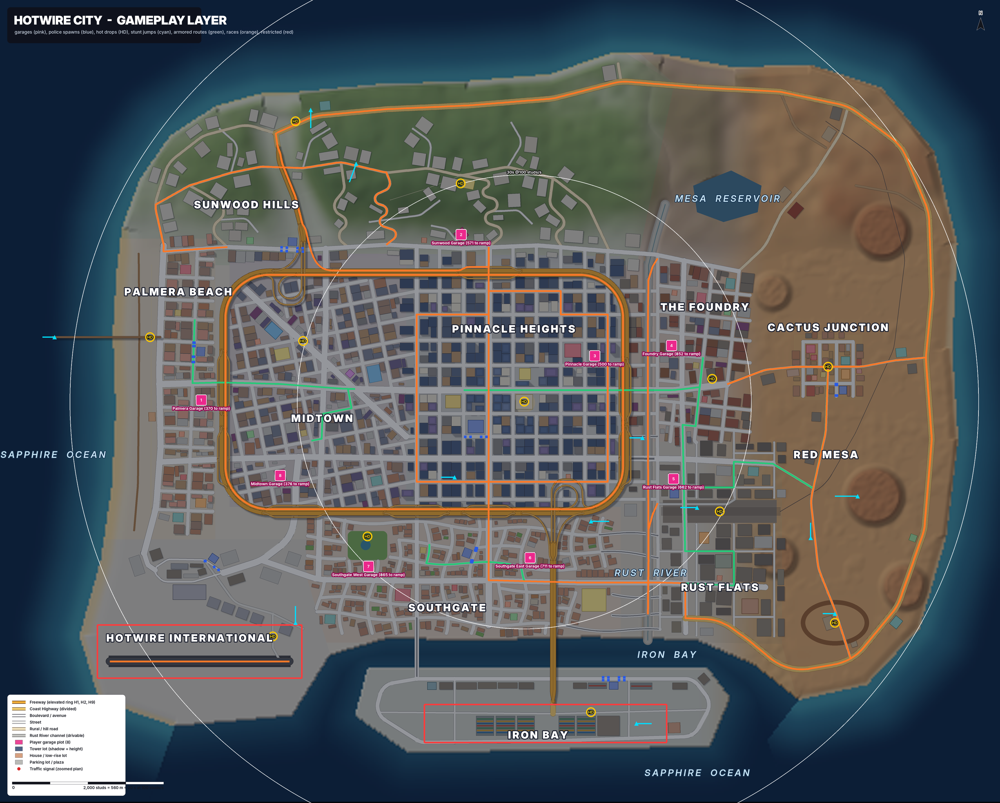

# Hotwire City v2 — World Spec

This is the binding world design for v2. It follows `docs/v2/research/00_LEAD_DIRECTION.md`:
- grounded GTA V realism;
- real scale;
- an island coastal city inspired by Los Santos and Vice City, under names of our own.

The whole world is **data**. Three modules hold it:
- `src/shared/Config/WorldLayout.luau` is the authored data, plus the code that expands it.
- `src/shared/Util/WorldQuery.luau` answers runtime questions about it.
- `src/shared/Util/WorldGen.luau` holds the geometry and graph algorithms.

Every number in this document is produced by that code. `lune run tools/world/stats.luau` prints them, and `tests/spec/worldlayout.spec.luau` guards them. To migrate the v1 systems, see `MIGRATION.md`.

| Plan | Image |
|---|---|
| Whole island |  |
| Core (Pinnacle Heights) |  |
| Gameplay layer |  |

To regenerate the images, run `lune run tools/world/export_layout.luau build/world_layout.json 24`, then `python3 -I tools/world/render_plan.py build/world_layout.json docs/v2/world`.

---

## 1. Scale

1 stud ≈ 0.28 m. These are the constants in `WorldLayout.Scale`:

| Thing | Studs | Real |
|---|---|---|
| Travel lane | 12.5 | 3.5 m |
| Curb parking lane | 9 | 2.5 m |
| Sidewalk (suburb / downtown) | 10–14 (13 default) | 2.8–3.9 m |
| Curb height | 0.6 | 17 cm |
| Storey (floor to floor) | 12.5 | 3.5 m |
| Car (sedan) | 17 × 7 | 4.8 × 2.0 m |
| Character | 5.5 | ~1.6 m |
| Freeway deck above grade | 28 | 7.8 m |
| Extra height per interchange level | 26 | 7.3 m |
| Minimum clearance between crossing roads | 16 | 4.5 m |
| Parking spot pitch | 24 | 6.7 m |

**Heights**
- Sea level is 0.
- The city basin and all city roads sit at grade **Y = 12**.
- The H1 deck is at 40.
- Flyovers are at 66.
- The Iron Bay Bridge apex is at 66.
- The Sunwood crest is at about 230–250, and Starview Observatory at 224.

**Axes**
- +X is east, and −Z is north, which is up on the plan.
- Traffic drives on the right.

## 2. Size, and why

| | Studs | Meters |
|---|---|---|
| Mainland extents | 11,620 × 8,920 (X −5,560..6,060, Z −4,720..4,200) | 3.3 × 2.5 km |
| Port island | ~4,800 × 1,100 | |
| Playable box (invisible walls) | X ±6,300, Z −5,100..4,900 | |
| Road network | 362,000 studs (~101 km) in 950 edges / 624 nodes | |

**Crossing time** is measured as road distance from the real route in `WorldQuery.route`. The average speed is what a car actually sustains with turns, lights and traffic.

| Trip | Road studs | @70 st/s (starter–sedan) | @100 (sports) | @140 (super) |
|---|---|---|---|---|
| Palmera Pier → east coast (W–E crossing) | 10,775 | **2.6 min** | 1.8 min | 1.3 min |
| Northpoint → Iron Bay port (N–S, via Coast Hwy) | 15,723 | 3.7 min | 2.6 min | 1.9 min |
| Sunwood Blvd → Southgate shore (core N–S) | 4,994 | 71 s | 50 s | 36 s |
| Hotwire Plaza → airport terminal | 6,523 | 93 s | 65 s | 47 s |
| H1 ring lap | 15,704 | — | — | 131 s @120 |
| Coast Highway Loop race | 29,913 | — | 5 min | 3.6 min |

`Config/Cars` top speeds run from 66 (Rustbucket) to 190 studs/s; the HUD shows 45 mph for the Rustbucket at 70 studs/s. A mid-tier car averages about 70–100 studs/s on mixed roads. Crossing the island therefore takes **~2–4 minutes**, which is GTA V's feel for crossing Los Santos.

**Why not bigger.** A server holds 8 players. The core (ring + Southgate + Foundry + Rust Flats) is about 6,500 × 5,000 studs, and every point in it is within a 30–60 s straight-line drive of Hotwire Plaza (the white rings on the gameplay plan). The server clock keeps pulling players together: Hot Drops, armored trucks every ~5 minutes, and heists. The countryside, the hills and the Coast Highway loop are where chases, races and escapes stretch out. On a 10–15k-stud island, 8 players would never meet.

**Why not smaller.** At real scale, an avenue is 104 studs from building face to building face, and a downtown block is about 300 studs. A smaller island cannot hold a skyline core, a beach strip, hills, a port, an airport and a desert loop. It would also bring back the "toy" look of v1, which was 1,600 studs square.

## 3. Geography and terrain

The coastline is a polygon (`WorldLayout.Coast`), and each segment has a kind that shapes the shore:

| Kind | Shore profile | Where |
|---|---|---|
| `beach` | 300-stud sand band, from Y 0.8 at the waterline up to the grade | Palmera Beach (whole west coast), Hidden Cove, Sandpiper Bay, Driftwood Beach |
| `cliff` | 55-stud band, so the hills drop straight into the sea | North-west and north coast under Sunwood Hills, north-east cape |
| `rock` | 140-stud band | Most of the east coast, Northpoint |
| `quay` | Vertical concrete wall, 26 deep | Iron Bay channel (both banks), port island, airport sea wall |

**Seabed.** One smooth shelf everywhere, at 0.05 slope down to −58. There are no seams between coast kinds.

**Terrain zones** are in `WorldLayout.TerrainZones`. The height function is `WorldLayout.heightAt(x, z)`, which includes the river and reservoir carves. `gradeAt` is the same without the carves.

| Zone | Shape |
|---|---|
| City Basin | Flat at Y 12: Downtown, Midtown, Southgate, Foundry, Rust Flats, port, airport. |
| Sunwood Hills | North of the hill foot (Z ≈ −2,000). Rises to a 230–250 crest at Z ≈ −3,050, with crest height varying along X and two noise octaves (±34), then falls to a plateau over the north cliffs. |
| Sunwood Canyon | A valley carved along the H9. The floor climbs to Y 58 at the pass and drops toward Hidden Cove. |
| Red Mesa Foothills | Rolling 70–140 hills north of the Foundry, holding the Mesa Reservoir (water at Y 74) behind its dam. |
| Red Mesa Desert | Dunes (±13) with a gentle rise to the east coast, and five flat-topped mesas 70–130 tall. |
| Rust River | A concrete storm channel 124 wide at the top with an 88-wide floor, from Y −6 in the north to −9 in the south (18–21 deep). It is dry: a flood gate at Z 2,860 closes the mouth to Iron Bay. North of Sunwood Blvd it becomes a natural creek bed. |
| Flatten pads | Cactus Junction (Y 24), Dustbowl Speedway (Y 20), Starview Observatory summit (Y 224). |

Every road has its own vertical profile (§5.6). The terrain builder must **grade the terrain to the roads**, cutting and filling along the road corridors. Edges report `fill`, the height above the natural grade.

## 4. Districts

District polygons are in `WorldLayout.Districts`, and `districtAt` returns the most specific match. Each district carries:
- a facade **style key**;
- **PBR MaterialVariant** keys;
- a height range, with an optional skyline peak;
- lot rules, a police heat level and a street-car tier.

The street-car tier (`carTier`) makes districts soft progression gates, as the brief asks: the richer the district, the better the cars and the heavier the police.

| District (id) | Identity | Style key / materials | Heights | Lots (frontage × depth, setback) | Heat | Street cars |
|---|---|---|---|---|---|---|
| **Pinnacle Heights** (`downtown`) | Financial core and skyline. Glass towers, a dense street wall, one-way pairs. Pinnacle Tower (760) is the tallest. | `glass_towers`: GlassCurtain, Concrete, BrushedMetal, Granite | 70–640, peak at (150, −200) | 110–170 × to mid-block, 0–6 | 4 | sports |
| **Midtown** (`midtown`) | Shopping, hotels, offices and apartments. The **Gilded Mile** diagonal boulevard runs through it, with Hotwire Motors, Glitter & Gold and Lucky Seven Casino. | `commercial_midrise`: Stucco, Brick, Glass | 30–220 | 70–130 × to mid-block, 0–8 | 3 | sports |
| **Palmera Beach** (`beach`) | Miami-deco beach strip: Palmera Drive with a palm median, palm park, boardwalk, Palmera Pier with the Ferris wheel, Muscle Beach. | `beach_deco`: PastelStucco, WhiteConcrete, Wood | 24–150 | 70–120 × 80–110, 4–12 | 2 | muscle |
| **Sunwood Hills** (`hills`) | Mansions on winding roads, the **SUNWOOD** sign, Starview Observatory, Skyline Drive and the Canyon Bridge. | `hills_mansion`: WhiteStucco, Travertine, Glass | 22–42 | 150–230 × 150–200, 30–50 | 3 | super |
| **The Foundry** (`foundry`) | Arts district: brick lofts, warehouses, breweries and galleries. | `brick_lofts`: Brick, CorrugatedMetal | 24–120 | 80–150 × to mid-block | 2 | muscle |
| **Rust Flats** (`rust`) | Industry, the rail yard, Rusty's Chop Shop, the Stackhouse armored-truck depot. | `industrial`: CorrugatedMetal, RustyMetal | 22–70 | 150–260 × 140–220 | 1 | beater |
| **Southgate** (`southgate`) | South-side suburbs: curvy streets, front yards, corner stores, Echo Park, Iron Bay Arena. | `suburb_stucco`: Stucco, RoofTile, WoodSiding | 16–42 | 55–72 × 90–110, 18–24 | 2 | sedan |
| **Iron Bay** (`port`) | Container terminal island: 8 gantry cranes, a docked ship, Port Authority Police. Restricted. | `port` | 20–64 | Container yards + warehouses | 4 | hyper |
| **Hotwire International** (`airport`) | Runway 09/27 (2,370 × 150), terminal loop, hangar row with rare spawns. Airside is restricted. | `airport` | 20–90 | Hangars | 5 | hyper |
| **Cactus Junction** (`cactus`) | Desert town: Main Street, motel, diner, sheriff, gun shop, gas. | `desert_town`: Adobe, WoodSiding | 14–36 | 70–110 × 80–120 | 1 | muscle |
| **Red Mesa** (`mesa`) | Countryside and desert: Coast Highway loop, mesas, wind farm, quarry, reservoir, Dustbowl Speedway, Northpoint Lighthouse. | `desert_rural` | 14–30 | Sparse farms | 1 | muscle |

**Lot generation.** This is *frontage subdivision* (§7), so blocks always read as lines of buildings along streets, never as random scatter. The result is 1,318 lots:

| District | Lots |
|---|---|
| downtown | 312 |
| midtown | 308 |
| southgate | 261 |
| beach | 119 |
| foundry | 112 |
| hills | 74 |
| rust | 56 |
| cactus | 34 |
| airport | 16 |
| port | 16 |
| mesa | 10 |

These include 55 towers of 20 floors or more.

## 5. Roads

The network is an **explicit multi-level graph** (`WorldLayout.Nodes` / `Edges`):
- Ground streets, freeway decks (layer 1), flyovers (layer 2) and the sunken channel (layer −1) cross each other without connecting.
- Ramps join the levels at their endpoints.
- The graph is **strongly connected**: every road can be reached from every road with one-ways respected. A test checks this.
- It has 504 intersections: 260 signalized, 67 all-way stop, 104 two-way stop, 62 freeway merges and 11 yields.

### 5.1 Classes and cross-sections

Widths are curb to curb (the `width` field). Sidewalks are given per side.

| Class | Lanes | Median | Parking | Width | Sidewalk | AI speed | Examples |
|---|---|---|---|---|---|---|---|
| `freeway` (one carriageway) | 3 (ring) / 2 | 3-stud barrier between carriageways | — | 49.5 / 37 | — | 100 | H1, H2, H9 |
| `ramp` | 1 | — | — | 18.5 | — | 60 | Diamonds, trumpets |
| `highway` | 2 + 2 | 16 | — | 78 | — | 88 | Coast Highway |
| `boulevard` | 3 + 3 (or 2 + 2 + parking) | 12–16 | Optional | 87 / 84 | 14 | 62 | Crown, Liberty, Palmera Dr, Airport Blvd |
| `avenue` | 2 + 2 | 0–18 | Yes | 68–94 | 13 | 58 | Mission, Sunwood Blvd, Harbor, Vista, Gilded Mile, Foundry Ave, Southgate Ave |
| `street` | 1 + 1, or one-way 2 | — | Both curbs | 43 | 12–14 | 44 | District grids |
| `rural` | 1 + 1 | — | — | 35 | Shoulders | 70 | Hills roads, Cliffside, Red Mesa Rd, Dustbowl Rd |
| `dirt` / `service` | 1 + 1 | — | — | 29 / 29 | — | 25–40 | Quarry, wind farm, hangar, rail yard, channel ramps |
| `pier` / `channel` / `runway` | — | — | — | — | — | — | Drivable specials with no AI traffic |

### 5.2 Freeways

- **H1 Ring Freeway.**
  - An elevated loop around Midtown and Pinnacle Heights, 3 + 3 lanes on a 28-stud deck.
  - Rounded rectangle (−3,650..1,650) × (−1,800..1,350) with 600-radius corners, so a lap is 15.7k studs.
  - Every surface street passes under it.
  - It runs along the hill foot, along the Rust River, and between downtown and Southgate, the way the 101, 5 and 10 run in LA.
- **H2 Port Expressway.**
  - Leaves the ring's south leg at the **Iron Bay Interchange** and runs south over Southgate on the deck.
  - Climbs to 66 over the channel on the cable-stayed **Iron Bay Bridge**, then descends to grade on the port island.
  - Ends at Container Road.
- **H9 Sunwood Freeway.**
  - Leaves the ring's north leg at the **Sunwood Interchange**, comes down off the deck into **Sunwood Canyon**, and climbs at ≤ 7% to the pass.
  - Ends at a signal at Hidden Cove, where the **Coast Highway** begins.
- **Interchanges.**
  - **Two trumpet interchanges**, Sunwood and Iron Bay. Each has all six movements:
    - one bridge carries two ramps over the ring;
    - a 270° loop;
    - a sweeping semi-directional flyover at Y 66;
    - two direct ramps.
  - **Eight diamonds** connect the ring to the surface:
    - Liberty Avenue (north and south legs);
    - Crown Boulevard (east and west);
    - Mission Avenue (east and west);
    - Harbor Avenue (south);
    - Airport Boulevard (south).
  - Diamond ramps run parallel to the deck, 99 studs off its centerline, and end at signalized T-junctions on the avenue.
- **Coast Highway (H9 continued).** A divided rural highway from Hidden Cove along the north cliffs, past Northpoint, down the whole east coast and back into Rust Flats. Together with the ring it forms the scenic speed loop (about 30k studs).

### 5.3 Arterials (hand placed, so the city is not a uniform grid)

| Road | Type | Route |
|---|---|---|
| **Crown Boulevard** | E–W spine | Palmera Dr, then Midtown with a gentle curve, then Downtown, then over the Rust River into the Foundry. Becomes **Red Mesa Road** to Cactus Junction and the east coast. |
| **Mission Avenue** | E–W | Beach to Rust Flats. |
| **Sunwood Boulevard** | Curvy E–W | Along the foot of the hills, like Sunset Blvd. |
| **Liberty Avenue** | N–S | Downtown's 3 + 3 spine, from Sunwood Blvd to the Southgate shore. |
| **Harbor Avenue** | N–S | Downtown's west edge, over the low Harbor lift bridge to the port. |
| **Gilded Mile** | NW–SE | A diagonal through Midtown with an 18-stud palm median. It crosses Crown and the rotated grid at angles, which creates GTA-style odd blocks. |
| **Vista Avenue** | N–S | Midtown to Southgate. |
| **Foundry Avenue** | N–S | East side, plus **Riverside Drive** along the river's east bank. |
| **Palmera Drive** | N–S | Beach boulevard with a palm median. North of the beach it becomes **Cliffside Road**. |
| **Airport Boulevard** and **Terminal Drive** | — | Airport Blvd, and the airport's one-way terminal loop. |
| **Southgate Avenue** | — | Curves through the suburbs, the arena and Rust Flats. |
| Hills roads | — | **Skyline Drive** follows the ridge (Mulholland parody) and crosses the canyon on the **Canyon Bridge**. Switchbacks: **Sunwood Canyon Road**, **Starview Road**, **Vista del Mar Drive**, **Laurel Canyon Drive**, **Coldwater Drive**. Mansion cul-de-sacs: Ocean Crest, Bel Mar, Hollow Oak, Summit Ridge, Glen Oaks, Mirador, Sierra Vista, Sunwood Terrace. |
| Countryside | — | Foothill Road (to the reservoir dam and the wind farm), Dustbowl Road (Cactus Junction to the Speedway), Mesa Cutoff, Quarry Road, Windfarm Road, Northpoint Road. |
| Port | — | Terminal Way ring, Container Road, Quay Road, Dock Street. |
| Specials | — | **Palmera Pier**, which you can drive onto (no traffic). The **Rust River Channel**, a 4.4k-stud drivable riverbed reached by ramps from Riverside Drive. **Runway 09/27**, used for the Airport Drag race. The Rail Yard service road. |

### 5.4 District grids (generated, then cleaned)

Each grid is `{origin, angle, street offsets, clip polygon, one-way pattern, warp, superblock drop}`:

| Grid | Layout |
|---|---|
| Downtown | Axis aligned, irregular ~310–330 spacing. **Alternating one-way pairs**, 2 lanes plus parking, like downtown LA. Streets pass under the ring and bridge the river to Riverside Dr. |
| Midtown | Rotated **−11°**, 300 × 270, 12% of interior block sides dropped (superblocks and T-junctions). |
| Palmera Beach | Aligned with the drive. Cross streets every ~280, plus Breaker Street. |
| Southgate | **Warped** with a 55-stud sine at a 1,100 wavelength, so streets curve the way suburban ones do. 340 × 250. |
| Foundry | Rotated **+6°**, 320 × 300. |
| Rust Flats | 500 × 430 industrial blocks, interrupted by the rail yard. |
| Cactus Junction | A tiny 3 × 4 grid around Main Street. |

**Cleanup rules**
- Generated streets are cut wherever they would:
  - run into a ramp still lower than grade + 20;
  - run along under a deck;
  - parallel an arterial within 115 studs;
  - leave the land;
  - enter a reserved area: the rail yard, Hotwire Plaza, Echo Park, the arena superblock, or along the channel.
- Loose ends are extended up to 170 studs onto the road they point at, then snapped.
- Dead-end stubs under 130 studs are pruned.
- Generated one-way streets that dead-end become two-way.
- Anything still outside the main strongly connected component is dropped. That is 3 tiny generated fragments; authored roads are never dropped, and a test checks this.

### 5.5 Intersections and signals

Each `Intersection` has its approaches (edge, in/outbound, heading, class), a control type, a clear radius (max half-width + sidewalk) and signal phases.

**Control types**

| Situation | Control |
|---|---|
| Freeway or deck node | merge |
| Ramp terminal | signal |
| Two or more avenues / boulevards | signal |
| Avenue × street in urban districts | signal (elsewhere: two-way stop) |
| Downtown / Midtown grid with 4+ approaches | signal |
| Suburbs, Cactus Junction, beach | all-way stop |
| Pier / channel / runway / service | yield |

**Phases**
- Opposite approaches are paired, and the major road goes first: 24 s green for majors, 16 s for minors, then 3 s amber and 1.5 s all-red.
- `offset = x / 58 mod cycle` gives an east–west **green wave** at avenue speed.
- `WorldQuery.signalState(id, approach, serverTime)` is a pure function of time, so clients render signal heads with no replication, and traffic and police read the same state.

### 5.6 Vertical alignment

Every ground road follows the terrain **grade-limited**:

| Road type | Max grade |
|---|---|
| Highways | 8% |
| Avenues | 10% |
| Streets | 13% |
| Hill streets | 15% |

- Each road is **pinned** to the heights of the roads it joins or crosses, so junctions always meet.
- Freeway decks use profiles: a constant deck, eased ramps (≤ 10%), and humped flyovers.
- Skyline Drive keeps a level deck across Sunwood Canyon (the Canyon Bridge).

**What the tests enforce**
- Grades: ramps and freeways ≤ 11%, everything else ≤ 18%.
- **Every crossing without a junction has at least 14 studs of vertical clearance.** This covers streets under the ring, the 18–21-deep channel under its dozen street bridges, and flyovers over ramps.

## 6. Places

### 6.1 Player garages (8 plots)

- There is one garage per district, in a ring around the core. None is downtown-central, and none is on the port island, which only two bridges reach and so would be a police trap.
- Each faces a street, with a 140 × 150 reserved footprint and a curbside spot for the first stolen car (`curbSpot`).
- Each is **350–870 studs from a freeway on-ramp**, the escape route.
- Garage-to-garage road distance is **1,537–7,582 studs** (15–75 s at 100 studs/s). A raid therefore always involves a real getaway drive that the victim can intercept. Next-door garages would make theft instant, and a far-flung layout would make defending pointless.

| # | Plot | District | Position | To on-ramp |
|---|---|---|---|---|
| 1 | Palmera Garage | Palmera Beach | (−3,943, −119) | 370 |
| 2 | Sunwood Garage | Sunwood Hills (foot) | (−513, −2,304) | 571 |
| 3 | Pinnacle Garage | Pinnacle Heights east | (1,250, −704) | 500 |
| 4 | Foundry Garage | The Foundry | (2,264, −840) | 852 |
| 5 | Rust Flats Garage | Rust Flats | (2,290, 920) | 662 |
| 6 | Southgate East Garage | Southgate | (395, 1,961) | 711 |
| 7 | Southgate West Garage | Southgate | (−1,735, 2,076) | 865 |
| 8 | Midtown Garage | Midtown | (−2,901, 875) | 376 |

`plot.cframe` keeps v1's contract: the ground center, with LookVector pointing out of the door. That means the `Config/Map.Garage` local offsets keep working, and the 140 × 150 footprint leaves a ~30-stud driveway apron in front.

**Street spawns** come from **7,385 curb parking spots**. Each spot carries its district `tier`, so cheap cars spawn around Rust Flats and Southgate, and rare ones in the Hills, the airport and the port.

### 6.2 Points of interest (64)

All POIs are snapped to a street frontage. Each footprint is verified clear of every road and every other footprint, and is reachable by road (tests check all three). Every name below is ours; the tests reject Rockstar names.

| Kind | Name (district) |
|---|---|
| Hub / spawn fallback | **Hotwire Plaza** (Pinnacle Heights). Cash rain, events, default spawn. |
| Dealerships | **Hotwire Motors** (Midtown, Crown Blvd) and **Legendaire Autos** (Gilded Mile, luxury). |
| Gun shops | **Lock & Load**: Southgate, Foundry, Palmera, Red Mesa. |
| Bank heist | **Pinnacle Reserve Bank** (downtown, Crown Blvd). The vault target is ~500 studs from HCPD HQ. |
| Bank branches (armored stops, robbable) | **Coinstack Savings**: Midtown, Palmera, Southgate, Foundry, Red Mesa. |
| Jewelry | **Glitter & Gold Jewelers** (Midtown). |
| Convenience stores (robbable) | **QuikStop 24** (Southgate, Rust Flats, Sunwood), **Sip-N-Go** (Palmera, Foundry, Pinnacle), **Lucky Mart** (Midtown, Red Mesa). That is 8 in all. |
| Gas | **Petrolux**, **Sunburst Gas**, **Fuel Rush**. 9 stations, including Hidden Cove, Red Mesa and Dustbowl on the highway loop. |
| Police | **HCPD Headquarters** (downtown; jail, busted release, helipad). Precincts: Palmera, Southgate, Sunwood, Eastside. Plus **Red Mesa Sheriff**, **Port Authority Police** and **Airport Police**. 8 stations, each with 4–8 spawn lanes. |
| Hospitals (WASTED respawn = nearest) | **Mount Mercy Medical Center** (downtown, helipad), **Southgate Community Hospital**, **Palmera Beach Clinic**, **Foundry Urgent Care**, **Red Mesa Medical**. |
| Mod / customs | **Hotwire Customs**: Rust Flats, Palmera, Red Mesa. |
| Spray (lose stars) | **Fresh Coat**: Midtown, Southgate, Foundry, Sunwood, Coastside. |
| Chop | **Rusty's Chop Shop** (Rust Flats junkyard) and **Dockside Salvage** (port). |
| Armored trucks | **Stackhouse Security Depot** (Rust Flats). |
| Landmarks with lots | **Pinnacle Tower** (760 studs, about 213 m, roof helipad), **Lucky Seven Casino** (future heist), **Iron Bay Arena** (superblock), **Starview Observatory**. |
| Other | HCI Terminal, Iron Bay Harbor Master, Muscle Beach Gym, Sleepy Cactus Motel, Rattlesnake Diner. |

### 6.3 Landmarks, zones, events

- **Landmarks** (`WorldLayout.Landmarks`):
  - **SUNWOOD sign**: 720 studs wide, on the hills facing the city, lit at night.
  - Canyon Bridge, Iron Bay Bridge (cable-stayed) and Harbor Bridge.
  - Palmera Pier and the Palmera Wheel.
  - The Boardwalk.
  - Northpoint Lighthouse.
  - Red Mesa Wind Farm and Mesa Reservoir Dam.
  - Dustbowl Speedway and Red Mesa Quarry.
  - The Rail Yard.
  - Iron Bay gantry cranes, plus a container ship docked at the south quay.
  - The HCI Control Tower and Hangar Row.
  - Echo Park ballfield.
  - Hidden Cove.
  - The Red Mesa buttes.
- **Hot Drop zones (12)**, one or more per district, all open, on land and within 200 studs of a road:
  - Hotwire Plaza
  - Palmera Pier lot
  - Gilded Mile rooftop lot
  - Echo Park
  - Rail Yard
  - Brewery lot
  - Container Yard
  - Hangar Apron
  - Observatory lot
  - Cactus Junction
  - Speedway infield
  - Hidden Cove lookout
- **Stunt jumps (12).** Each has a ramp lip CFrame, a landing point and a minimum speed:
  - Pier Plunge (into the sea)
  - River Leap (across the channel)
  - Boxcar Hop
  - Container Stack
  - Skyline Drop
  - Unfinished Ramp (at the Iron Bay Interchange)
  - Hangar Roof
  - Mesa Launch
  - Dune Kicker
  - Parking Deck
  - Cove Cliff
  - Speedway Tabletop
- **Helipads (7):**
  - Mount Mercy roof
  - HCPD roof
  - Pinnacle Tower roof
  - Two at the airport
  - The port
  - A Sunwood estate
- **Safe zones:**
  - Your own garage, which `PlotService` enforces (owner only).
  - Hospital doors: 5 s of spawn protection and no weapons.
  - Dealership showrooms: no weapons.
- **Restricted zones** (GTA rule):
  - **HCI Airside**: 1★ on entry, 3★ after 10 s.
  - **Iron Bay Container Terminal**: 1★ past the gate.
- **Armored trucks.** One every ~5 minutes, on one of four runs (Downtown, Midtown & Beach, Southgate, Red Mesa). Each run is 4.2k–6.9k studs, about 75–125 s at truck speed, so a crew has a real window to intercept.
- **Races (7):**

  | Race | Length (studs) |
  |---|---|
  | Downtown Sprint (2 laps) | 10.1k |
  | Ring Run | 15.7k |
  | Coast Highway Loop | 29.9k |
  | Sunwood Canyon Run | 6.0k |
  | Channel Run (in the Rust River) | 6.2k |
  | Airport Drag (runway) | 2.4k |
  | Red Mesa Rally | 10.9k |

- **Spawns** (`WorldLayout.Spawns`):

  | Spawn set | Contents |
  |---|---|
  | `parking` | 7,385 curb spots: CFrame, edge, district, car tier |
  | `police` | Lane CFrames by station |
  | `traffic` | Edges weighted by length × lanes |
  | `hospital` | Respawn CFrames |
  | `default` | Hotwire Plaza |
  | `bustedRelease` | HCPD HQ steps |

- **Extra geometry:** `Rails` (rail yard, Red Mesa freight line), `LevelCrossings`, `Paths` (boardwalk, palm park, Echo Park loop, plaza, Starview trail) and `Bridges`.

## 7. Blocks and lots: how the city fills in

Every ground street side (except freeways, ramps, bridges, decks and highways) is a **frontage**. Each one is filled like this:
- It runs from the back of the cross street's sidewalk at one corner to the same point at the other corner.
- It is split into lots whose widths are drawn from the district rule and normalized so they fill the frontage exactly. Gaps between lots range from 2 (downtown) to 160 (farms).
- In dense districts (downtown, midtown, beach, foundry), each lot's depth is probed to the next road behind it, and the lot reaches half way, so two facing lots meet mid-block. Elsewhere the rule depth applies, capped at half of that probe.
- Each lot is rejected if it overlaps a road footprint (curb + sidewalk), another lot or a POI, or if it sits in water, in a reserved open area, or on a slope of more than 46 studs.
- Boulevards and avenues are processed first, so corner lots face the main road.
- `use` is drawn from the district's weights. Height comes from the use (houses 20–34, warehouses 34–56 and so on), or for towers and midrises from the district range, shaped by the skyline peak falloff.

**What builders get from each lot**
- `cframe`: ground center at street level, with LookVector toward the street.
- `size`: X frontage, Y target height (0 = open lot), Z depth.
- `floors`, `style` and `seed`, for deterministic facade variety.

## 8. Gameplay flow on this map

### 8.1 The first five minutes

The example player is assigned Palmera Garage.

| Time | What happens |
|---|---|
| 0:00 | Spawn inside **Palmera Garage**, a block off Palmera Drive. A beater sits on `curbSpot` right outside the door. |
| 0:10 | Hotwire it with a short hold. There is no heat on the first steal. Loop the block and drive into the garage drop-off. Income starts ticking. |
| 1:00 | The arrow points at **Hotwire Motors** on Crown Boulevard: 2.3k studs east, under the H1 at the Crown diamond, about 35 s. You pass rare cars in Midtown's sports-tier parking on the way. |
| 2:00 | First real steal on the Gilded Mile, a sports car. 1★. An HCPD cruiser rolls out of **HCPD Palmera Precinct** (Palmera Dr). |
| 2:30 | Escape: up the **Crown west on-ramp** (370 studs from home). On the ring, police can't box you in. Exit at Mission and pull into **Fresh Coat Midtown** to clear the star. |
| 3:30 | Server toast: a **Hot Drop** at the Palmera Pier lot, 1.1k studs from your garage. Everyone converges, and it's your first PvP moment. |
| 4:30 | Deliver it home. A **Lock & Load** sits four blocks south on the beach grid: buy the first pistol. The armored-truck countdown appears. |

### 8.2 A chase route

1. Steal a hyper car in **HCI Hangar Row** at the airport. The airside restriction plus the rarity puts you at 3★, and Airport Police spawn on Terminal Drive.
2. Run up Airport Blvd and take the **Airport on-ramp** onto the H1, eastbound past Southgate.
3. At the **Iron Bay Interchange**, either take the flyover onto the H2, or stay on the ring.
   - The H2 crosses the **Iron Bay Bridge** onto the port. The island has only two bridges and the container terminal adds a star, so it is a trap unless you know about **Dockside Salvage**.
   - The smarter line stays on the ring and exits at the **Mission east diamond**. Cross the Rust River bridge, turn north on Riverside Drive, and drop into the **Rust River Channel** at the south ramp. Sprint 3.3k studs north under nine street bridges, where the helicopter loses sight at every one, and climb out at the north ramp onto Sunwood Boulevard.
4. Break line of sight in the **Sunwood Canyon Road** switchbacks, then lie low at **Fresh Coat Sunwood**.

### 8.3 Heist getaway

The **Pinnacle Reserve Bank** sits on Crown Boulevard. HCPD HQ is 500 studs away, so it goes to 4★ and a helicopter immediately. There are three planned exits, each with a different risk:

| Exit | Route | Risk |
|---|---|---|
| North (fast) | Liberty Ave north for 1.6k, the **Liberty diamond** onto the H1, west to the **Sunwood Interchange**, the H9 up the canyon. Exit at Hidden Cove, then the Coast Highway east into Red Mesa, where heat drops to Sheriff level. | Freeway speed versus roadblocks at the trumpet. |
| East (underground) | Crown east, over the river, a hard right onto Riverside Drive, down the **north channel ramp**, and south in the channel to the south ramp by the rail yard. Then **Rusty's Chop Shop** or the Stackhouse depot alleys. | Tight; one ramp in and one out. |
| West (blend in) | Crown west through Midtown traffic on the Gilded Mile and the beach grid, ditch at **Palmera Pier**, swap cars from the parking lanes. | Slow; you're on foot for a moment. |

The crew splits across the exits, which is the betrayal moment from the brief.

## 9. Build budget and streaming

The world is generated server-side at boot from data and streamed to clients (StreamingEnabled ON). The estimated part counts below come from the same data, using per-use part costs for procedural facades and before meshes. See `tools/world/stats.luau`.

| Layer | Estimate | Notes |
|---|---|---|
| Roads | ~25.5k | 7,180 polyline segments. Ground segment: asphalt, 2 curbs, 2 sidewalks. Deck: deck, 2 barriers, a pier every 90 studs. Markings are textures or decals, never parts. |
| Junctions | ~2.5k | Box + crosswalk decals. Signal heads are meshes. |
| Lots → buildings | ~19.7k | Towers 34, midrises 16–18, houses 9, warehouses 8, open lots 3–6. Kit / Blender meshes replace boxes over time and don't count. |
| POIs | ~2.6k | ~40 each. |
| Street props built from parts | ~4.4k | Lamps, hydrants, benches. Prefer meshes. |
| **Total** | **~55k** | Under the 60k budget. |

**Streaming rules**
- `StreamingTargetRadius` 1,024, minimum 256. The H1 deck must be in the persistent set near the player while driving, so never stream out the road the player is on.
- Buildings are `Model.ModelStreamingMode = Atomic`.
- Towers and landmarks use `LevelOfDetail = StreamingMesh`, so the **skyline and the SUNWOOD sign stay visible beyond the radius**. This fixes v1's "the city is invisible from the sky".
- Terrain, generated from `heightAt`, is not parts.

**Boot cost.** Generation takes about 3 s in Lune, and is deterministic. Ship a **baked** data module, generated from the same code, so servers and clients load it instantly (`MIGRATION.md` §4).

## 10. Editing the world

- **Authored data** sits at the top of each section of `WorldLayout.luau`:
  - coast and terrain features;
  - district table;
  - freeway corridors (with `trumpet` and `diamond` generators);
  - arterials and hill roads (control polygons, filleted);
  - `GRIDS` (generator parameters);
  - `POI_DEFS` (approximate position, size, optional road);
  - `PLOT_DEFS`;
  - landmarks, zones and routes.
- **Positions are addresses.** A POI or plot names an approximate spot, and the generator snaps it to the nearest clear frontage. Moving a road moves its buildings with it.
- **After any edit**, run `lune run tests/run.luau worldlayout`. It checks:
  - connectivity and grades;
  - grade separation;
  - lots not overlapping roads or each other;
  - POIs and plots clear and reachable;
  - spawns on lanes and outside junctions;
  - bounds and scale;
  - determinism.
- **Then** run `lune run tools/world/stats.luau`, and re-render the plans and look at them.

## 11. Open items for later waves

- **A lane-level graph.** Turn connectors per approach (which lane may go where) are computed at runtime from approach headings today. If traffic needs it, bake them as data.
- **Bake step.** Add `tools/world/bake.luau`, which writes `Config/WorldLayoutBaked.luau`, plus a hash check at boot.
- **Interiors.** Bank vault, jewelry store and garage interiors are owned by their systems' footprints.
- **Seasonal or live-event variants.** Parade closures on Crown Boulevard and a Speedway event mode can be expressed as data flags on edges and zones.
